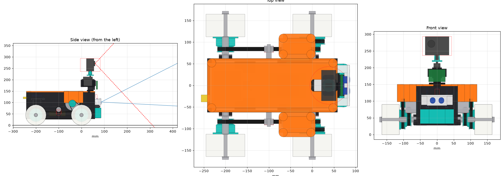
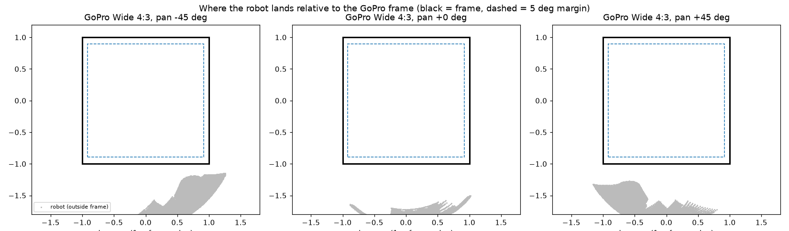

# honebot chassis - automated design check

Generated by `cad/check_design.py` from `cad/fusion/HonebotChassis/HonebotChassis.py` (same primitives Fusion builds). Re-run after any parameter change.

## Summary

| check | failures |
|---|---|
| clearance | 0 |
| holes | 0 |
| hole spacing | 0 |
| assembly | 0 |
| camera | 0 |
| terrain | 0 |
| structure (SF < 1.5) | 0 |
| sensor beam | 0 |
| routes | 0 |
| print | 0 |

Mass 4.03 kg, CG (-71, 0, 81) mm, 65 % on the front axle, sideways tip at 1.71 g.

## 1. Clearances

Every pair of parts that are not declared mates (bolted/sitting on each other) is checked. Required gap: 0.5 mm static, 3 mm when either part moves or is a swept keep-out volume (GoPro pan, wheels, belts, pulleys, USB plugs). Only pairs within 8 mm are listed.

| Part A | Part B | type | need (mm) | measured gap (mm) | result |
|---|---|---|---|---|---|
| axle_FL | battery | static | 0.5 | 5.0-8.0 | **OK** |
| axle_FR | battery | static | 0.5 | 5.0-8.0 | **OK** |
| axle_nut_FL | battery | static | 0.5 | 5.0-8.0 | **OK** |
| axle_nut_FR | battery | static | 0.5 | 5.0-8.0 | **OK** |
| battery | fuse_zone | moving | 3.0 | 5.0-8.0 | **OK** |
| deck | idler_L | moving | 3.0 | 3.0-5.0 | **OK** |
| deck | idler_R | moving | 3.0 | 3.0-5.0 | **OK** |
| deck | usb_keepout | moving | 3.0 | 2.0-3.0 | **OK** |
| deck | esp_ext_board | static | 0.5 | 5.0-8.0 | **OK** |
| esp_ext_board | esp32_usb | moving | 3.0 | 5.0-8.0 | **OK** |
| esp_ext_plate | esp_ext_wires | moving | 3.0 | 5.0-8.0 | **OK** |
| esp_ext_plate | xt60_plug | static | 0.5 | 5.0-8.0 | **OK** |
| esp_ext_spacers | esp_ext_wires | moving | 3.0 | 5.0-8.0 | **OK** |
| gy521 | gyro_screws | static | 0.5 | 3.0-5.0 | **OK** |
| gyro_mount | gyro_wires | moving | 3.0 | 3.0-5.0 | **OK** |
| motor_L | belt_L | moving | 3.0 | 3.0-5.0 | **OK** |
| motor_L | belt2_L | moving | 3.0 | 3.0-5.0 | **OK** |
| motor_R | belt_R | moving | 3.0 | 3.0-5.0 | **OK** |
| motor_R | belt2_R | moving | 3.0 | 3.0-5.0 | **OK** |
| motor_plate_L | plate_bolt_L0 | static | 0.5 | 3.0-5.0 | **OK** |
| motor_plate_L | plate_bolt_L1 | static | 0.5 | 3.0-5.0 | **OK** |
| motor_plate_L | plate_bolt_L2 | static | 0.5 | 3.0-5.0 | **OK** |
| motor_plate_L | deck | static | 0.5 | 5.0-8.0 | **OK** |
| motor_plate_R | plate_bolt_R0 | static | 0.5 | 3.0-5.0 | **OK** |
| motor_plate_R | tool_access_R0 | moving | 3.0 | 5.0-8.0 | **OK** |
| motor_plate_R | plate_bolt_R1 | static | 0.5 | 3.0-5.0 | **OK** |
| motor_plate_R | tool_access_R1 | moving | 3.0 | 5.0-8.0 | **OK** |
| motor_plate_R | plate_bolt_R2 | static | 0.5 | 3.0-5.0 | **OK** |
| motor_plate_R | tool_access_R2 | moving | 3.0 | 5.0-8.0 | **OK** |
| motor_plate_R | deck | static | 0.5 | 5.0-8.0 | **OK** |
| servo | gopro | moving | 3.0 | 5.0-8.0 | **OK** |
| shell | esp32 | static | 0.5 | 5.0-8.0 | **OK** |
| shell | esp32_usb | moving | 3.0 | 3.0-5.0 | **OK** |
| tub | wheel_pulley_FL | moving | 3.0 | 5.0-8.0 | **OK** |
| tub | wheel_pulley_RL | moving | 3.0 | 5.0-8.0 | **OK** |
| tub | wheel_pulley_FR | moving | 3.0 | 5.0-8.0 | **OK** |
| tub | wheel_pulley_RR | moving | 3.0 | 5.0-8.0 | **OK** |
| tub | reg_L | static | 0.5 | 3.0-5.0 | **OK** |
| tub | esc_L | static | 0.5 | 2.0-3.0 | **OK** |
| tub | reg_R | static | 0.5 | 3.0-5.0 | **OK** |
| tub | esc_R | static | 0.5 | 2.0-3.0 | **OK** |
| tub | esp_ext_plate | static | 0.5 | 5.0-8.0 | **OK** |
| tub | us_plug | moving | 3.0 | 3.0-5.0 | **OK** |
| us_bracket | us_plug | moving | 3.0 | 5.0-8.0 | **OK** |
| wheel_FL | belt_L | moving | 3.0 | 5.0-8.0 | **OK** |
| wheel_FR | motor_pulley_R | moving | 3.0 | 5.0-8.0 | **OK** |
| wheel_FR | belt_R | moving | 3.0 | 5.0-8.0 | **OK** |
| wheel_pulley_FL | axle_FL | moving | 3.0 | 5.0-8.0 | **OK** |
| wheel_pulley_FL | spacer_FL | moving | 3.0 | 3.0-5.0 | **OK** |
| wheel_pulley_FL | motor_L | moving | 3.0 | 5.0-8.0 | **OK** |
| wheel_pulley_FR | axle_FR | moving | 3.0 | 5.0-8.0 | **OK** |
| wheel_pulley_FR | spacer_FR | moving | 3.0 | 3.0-5.0 | **OK** |
| wheel_pulley_FR | motor_R | moving | 3.0 | 5.0-8.0 | **OK** |
| wheel_pulley_RL | axle_RL | moving | 3.0 | 5.0-8.0 | **OK** |
| wheel_pulley_RL | spacer_RL | moving | 3.0 | 3.0-5.0 | **OK** |
| wheel_pulley_RR | axle_RR | moving | 3.0 | 5.0-8.0 | **OK** |
| wheel_pulley_RR | spacer_RR | moving | 3.0 | 3.0-5.0 | **OK** |

Mated pairs (bolted / resting on each other) are checked for interpenetration deeper than 0.3 mm; 18 declared nests are exempt (alternatives: only one is fitted; bolt through the spacer; bolt through the wheel bearings; camera fingers interleave the buckle prongs; nut on its bolt; spacer reaches the recessed inner race).

Mated pairs: no interpenetration.

Clearance failures: **0**

## 2. Mounting-hole audit

For every hardware fastener hole: the hole axis must run through its host part for at least the required engagement (inserts: insert depth; through-holes: 2 mm) and a ring of material at r + max(1.5 mm, d/2) must surround it there (edge distance). Slots are checked at both ends.

| host | hole | for | type | d | engaged length (mm) | wall ring | result |
|---|---|---|---|---|---|---|---|
| tub | mast_flange_L | mast flange M4 | insert | 5.6 | 8.6 (need 8.0) | 100 % | **OK** |
| tub | mast_flange_R | mast flange M4 | insert | 5.6 | 8.6 (need 8.0) | 100 % | **OK** |
| tub | axle_sleeve_FL | inner axle sleeve 16 x 8.2 x 30.3 (through the boss) | clear | 16.4 | 29.9 (need 2.0) | 100 % | **OK** |
| tub | axle_sleeve_RL | inner axle sleeve 16 x 8.2 x 30.3 (through the boss) | clear | 16.4 | 29.9 (need 2.0) | 100 % | **OK** |
| tub | tension_L_0 | motor plate M3 (tension slot) | slot | 3.4 | 4.0 (need 2.0) | 100 % | **OK** |
| tub | tension_L_1 | motor plate M3 (tension slot) | slot | 3.4 | 4.0 (need 2.0) | 100 % | **OK** |
| tub | tension_L_2 | motor plate M3 (tension slot) | slot | 3.4 | 4.0 (need 2.0) | 100 % | **OK** |
| tub | pull_L | belt pull screw M3 x 25 (head on the boss) | clear | 3.4 | 7.2 (need 2.0) | 38 % | **OK** |
| tub | idler_L | idler M8 (vertical tension slot) | slot | 8.5 | 9.2 (need 2.0) | 31 % | **OK** |
| tub | lid_f_L | shell M3 | insert | 4.0 | 6.1 (need 6.0) | 100 % | **OK** |
| tub | lid_r_L | shell M3 | insert | 4.0 | 6.1 (need 6.0) | 100 % | **OK** |
| tub | deck_FL | deck M3 | insert | 4.0 | 6.1 (need 6.0) | 100 % | **OK** |
| tub | deck_RL | deck M3 | insert | 4.0 | 6.1 (need 6.0) | 100 % | **OK** |
| tub | door_L | bumper-door M4 thumb screw | insert | 5.6 | 12.6 (need 8.0) | 100 % | **OK** |
| tub | us_L | HC-SR04 bracket M3 | insert | 4.0 | 6.1 (need 6.0) | 100 % | **OK** |
| tub | axle_sleeve_FR | inner axle sleeve 16 x 8.2 x 30.3 (through the boss) | clear | 16.4 | 29.9 (need 2.0) | 100 % | **OK** |
| tub | axle_sleeve_RR | inner axle sleeve 16 x 8.2 x 30.3 (through the boss) | clear | 16.4 | 29.9 (need 2.0) | 100 % | **OK** |
| tub | tension_R_0 | motor plate M3 (tension slot) | slot | 3.4 | 4.0 (need 2.0) | 100 % | **OK** |
| tub | tension_R_1 | motor plate M3 (tension slot) | slot | 3.4 | 4.0 (need 2.0) | 100 % | **OK** |
| tub | tension_R_2 | motor plate M3 (tension slot) | slot | 3.4 | 4.0 (need 2.0) | 100 % | **OK** |
| tub | pull_R | belt pull screw M3 x 25 (head on the boss) | clear | 3.4 | 7.2 (need 2.0) | 38 % | **OK** |
| tub | idler_R | idler M8 (vertical tension slot) | slot | 8.5 | 9.2 (need 2.0) | 31 % | **OK** |
| tub | lid_f_R | shell M3 | insert | 4.0 | 6.1 (need 6.0) | 100 % | **OK** |
| tub | lid_r_R | shell M3 | insert | 4.0 | 6.1 (need 6.0) | 100 % | **OK** |
| tub | deck_FR | deck M3 | insert | 4.0 | 6.1 (need 6.0) | 100 % | **OK** |
| tub | deck_RR | deck M3 | insert | 4.0 | 6.1 (need 6.0) | 100 % | **OK** |
| tub | door_R | bumper-door M4 thumb screw | insert | 5.6 | 12.6 (need 8.0) | 100 % | **OK** |
| tub | us_R | HC-SR04 bracket M3 | insert | 4.0 | 6.1 (need 6.0) | 100 % | **OK** |
| motor_plate_L | pull_ins | belt pull screw M3 insert | insert | 4.0 | 6.1 (need 6.0) | 100 % | **OK** |
| motor_plate_L | ins_0 | motor plate <- wall M3 | insert | 4.0 | 6.1 (need 6.0) | 100 % | **OK** |
| motor_plate_L | ins_1 | motor plate <- wall M3 | insert | 4.0 | 6.1 (need 6.0) | 100 % | **OK** |
| motor_plate_L | ins_2 | motor plate <- wall M3 | insert | 4.0 | 6.1 (need 6.0) | 100 % | **OK** |
| motor_plate_R | pull_ins | belt pull screw M3 insert | insert | 4.0 | 6.1 (need 6.0) | 100 % | **OK** |
| motor_plate_R | ins_0 | motor plate <- wall M3 | insert | 4.0 | 6.1 (need 6.0) | 100 % | **OK** |
| motor_plate_R | ins_1 | motor plate <- wall M3 | insert | 4.0 | 6.1 (need 6.0) | 100 % | **OK** |
| motor_plate_R | ins_2 | motor plate <- wall M3 | insert | 4.0 | 6.1 (need 6.0) | 100 % | **OK** |
| deck | pi_0 | Raspberry Pi 5 M2.5 x 6 screw into a printed standoff | insert | 3.6 | 4.6 (need 4.5) | 100 % | **OK** |
| deck | pi_1 | Raspberry Pi 5 M2.5 x 6 screw into a printed standoff | insert | 3.6 | 4.6 (need 4.5) | 100 % | **OK** |
| deck | pi_2 | Raspberry Pi 5 M2.5 x 6 screw into a printed standoff | insert | 3.6 | 4.6 (need 4.5) | 100 % | **OK** |
| deck | pi_3 | Raspberry Pi 5 M2.5 x 6 screw into a printed standoff | insert | 3.6 | 4.6 (need 4.5) | 100 % | **OK** |
| deck | screw_FL | deck M3 | clear | 3.4 | 3.1 (need 2.0) | 100 % | **OK** |
| deck | screw_RL | deck M3 | clear | 3.4 | 3.1 (need 2.0) | 100 % | **OK** |
| deck | screw_FR | deck M3 | clear | 3.4 | 3.1 (need 2.0) | 100 % | **OK** |
| deck | screw_RR | deck M3 | clear | 3.4 | 3.1 (need 2.0) | 100 % | **OK** |
| wheel_pulley_FL | core_0 | M3 x 60 from the wheel's outer face through the core, 14 mm hole (holes drilled 3.0 -> 3.15 with the jig: they centre the pulley) | insert | 4.0 | 13.6 (need 6.0) | 100 % | **OK** |
| wheel_pulley_FL | core_1 | M3 x 60 from the wheel's outer face through the core, 14 mm hole (holes drilled 3.0 -> 3.15 with the jig: they centre the pulley) | insert | 4.0 | 13.6 (need 6.0) | 100 % | **OK** |
| wheel_pulley_FL | core_2 | M3 x 60 from the wheel's outer face through the core, 14 mm hole (holes drilled 3.0 -> 3.15 with the jig: they centre the pulley) | insert | 4.0 | 13.6 (need 6.0) | 100 % | **OK** |
| wheel_pulley_FL | core_3 | M3 x 60 from the wheel's outer face through the core, 14 mm hole (holes drilled 3.0 -> 3.15 with the jig: they centre the pulley) | insert | 4.0 | 13.6 (need 6.0) | 100 % | **OK** |
| wheel_pulley_RL | core_0 | M3 x 60 from the wheel's outer face through the core, 14 mm hole (holes drilled 3.0 -> 3.15 with the jig: they centre the pulley) | insert | 4.0 | 13.6 (need 6.0) | 100 % | **OK** |
| wheel_pulley_RL | core_1 | M3 x 60 from the wheel's outer face through the core, 14 mm hole (holes drilled 3.0 -> 3.15 with the jig: they centre the pulley) | insert | 4.0 | 13.6 (need 6.0) | 100 % | **OK** |
| wheel_pulley_RL | core_2 | M3 x 60 from the wheel's outer face through the core, 14 mm hole (holes drilled 3.0 -> 3.15 with the jig: they centre the pulley) | insert | 4.0 | 13.6 (need 6.0) | 100 % | **OK** |
| wheel_pulley_RL | core_3 | M3 x 60 from the wheel's outer face through the core, 14 mm hole (holes drilled 3.0 -> 3.15 with the jig: they centre the pulley) | insert | 4.0 | 13.6 (need 6.0) | 100 % | **OK** |
| wheel_pulley_FR | core_0 | M3 x 60 from the wheel's outer face through the core, 14 mm hole (holes drilled 3.0 -> 3.15 with the jig: they centre the pulley) | insert | 4.0 | 13.6 (need 6.0) | 100 % | **OK** |
| wheel_pulley_FR | core_1 | M3 x 60 from the wheel's outer face through the core, 14 mm hole (holes drilled 3.0 -> 3.15 with the jig: they centre the pulley) | insert | 4.0 | 13.6 (need 6.0) | 100 % | **OK** |
| wheel_pulley_FR | core_2 | M3 x 60 from the wheel's outer face through the core, 14 mm hole (holes drilled 3.0 -> 3.15 with the jig: they centre the pulley) | insert | 4.0 | 13.6 (need 6.0) | 100 % | **OK** |
| wheel_pulley_FR | core_3 | M3 x 60 from the wheel's outer face through the core, 14 mm hole (holes drilled 3.0 -> 3.15 with the jig: they centre the pulley) | insert | 4.0 | 13.6 (need 6.0) | 100 % | **OK** |
| wheel_pulley_RR | core_0 | M3 x 60 from the wheel's outer face through the core, 14 mm hole (holes drilled 3.0 -> 3.15 with the jig: they centre the pulley) | insert | 4.0 | 13.6 (need 6.0) | 100 % | **OK** |
| wheel_pulley_RR | core_1 | M3 x 60 from the wheel's outer face through the core, 14 mm hole (holes drilled 3.0 -> 3.15 with the jig: they centre the pulley) | insert | 4.0 | 13.6 (need 6.0) | 100 % | **OK** |
| wheel_pulley_RR | core_2 | M3 x 60 from the wheel's outer face through the core, 14 mm hole (holes drilled 3.0 -> 3.15 with the jig: they centre the pulley) | insert | 4.0 | 13.6 (need 6.0) | 100 % | **OK** |
| wheel_pulley_RR | core_3 | M3 x 60 from the wheel's outer face through the core, 14 mm hole (holes drilled 3.0 -> 3.15 with the jig: they centre the pulley) | insert | 4.0 | 13.6 (need 6.0) | 100 % | **OK** |
| bumper_door | thumb_L | M4 thumb screw | clear | 4.5 | 9.6 (need 2.0) | 100 % | **OK** |
| bumper_door | thumb_R | M4 thumb screw | clear | 4.5 | 9.6 (need 2.0) | 100 % | **OK** |
| us_bracket | screw_L | bracket M3 | clear | 3.4 | 27.2 (need 2.0) | 100 % | **OK** |
| us_bracket | eye_L | HC-SR04 transducer | clear | 18.0 | 3.1 (need 2.0) | 100 % | **OK** |
| us_bracket | screw_R | bracket M3 | clear | 3.4 | 27.2 (need 2.0) | 100 % | **OK** |
| us_bracket | eye_R | HC-SR04 transducer | clear | 18.0 | 3.1 (need 2.0) | 100 % | **OK** |
| shell | mast_flange_L | mast flange M4 thumb screw | clear | 4.5 | 4.1 (need 2.0) | 100 % | **OK** |
| shell | mast_flange_R | mast flange M4 thumb screw | clear | 4.5 | 4.1 (need 2.0) | 100 % | **OK** |
| shell | f_L | shell M3 | clear | 3.4 | 4.1 (need 2.0) | 100 % | **OK** |
| shell | r_L | shell M3 | clear | 3.4 | 4.1 (need 2.0) | 100 % | **OK** |
| shell | f_R | shell M3 | clear | 3.4 | 4.1 (need 2.0) | 100 % | **OK** |
| shell | r_R | shell M3 | clear | 3.4 | 4.1 (need 2.0) | 100 % | **OK** |
| mast | servo_ear_A | servo ear screw (self-tapping) | slot | 2.4 | 11.5 (need 2.0) | 100 % | **OK** |
| mast | flange_L | mast flange M4 thumb screw | clear | 4.5 | 4.1 (need 2.0) | 100 % | **OK** |
| mast | servo_ear_B | servo ear screw (self-tapping) | slot | 2.4 | 11.5 (need 2.0) | 100 % | **OK** |
| mast | flange_R | mast flange M4 thumb screw | clear | 4.5 | 4.1 (need 2.0) | 100 % | **OK** |
| pan_buckle | pivot | GoPro M5 thumb screw | clear | 5.5 | 9.0 (need 2.0) | 100 % | **OK** |
| motor_pulley_L | prop_0 | M3 x 12 low head into the bell | clear | 3.4 | 13.2 (need 2.0) | 100 % | **OK** |
| motor_pulley_L | prop_1 | M3 x 12 low head into the bell | clear | 3.4 | 13.2 (need 2.0) | 100 % | **OK** |
| motor_pulley_L | prop_2 | M3 x 12 low head into the bell | clear | 3.4 | 13.2 (need 2.0) | 100 % | **OK** |
| motor_pulley_L | prop_3 | M3 x 12 low head into the bell | clear | 3.4 | 13.2 (need 2.0) | 100 % | **OK** |
| motor_pulley_R | prop_0 | M3 x 12 low head into the bell | clear | 3.4 | 13.2 (need 2.0) | 100 % | **OK** |
| motor_pulley_R | prop_1 | M3 x 12 low head into the bell | clear | 3.4 | 13.2 (need 2.0) | 100 % | **OK** |
| motor_pulley_R | prop_2 | M3 x 12 low head into the bell | clear | 3.4 | 13.2 (need 2.0) | 100 % | **OK** |
| motor_pulley_R | prop_3 | M3 x 12 low head into the bell | clear | 3.4 | 13.2 (need 2.0) | 100 % | **OK** |
| esp_ext_plate | ext_insert_1 | SunFounder board M2 screw into a heat-set insert (same hole as the Pi's) | insert | 3.6 | 5.6 (need 4.5) | 100 % | **OK** |
| esp_ext_plate | ext_insert_2 | SunFounder board M2 screw into a heat-set insert (same hole as the Pi's) | insert | 3.6 | 5.6 (need 4.5) | 100 % | **OK** |
| esp_ext_plate | ext_insert_3 | SunFounder board M2 screw into a heat-set insert (same hole as the Pi's) | insert | 3.6 | 5.6 (need 4.5) | 100 % | **OK** |
| esp_ext_plate | ext_insert_4 | SunFounder board M2 screw into a heat-set insert (same hole as the Pi's) | insert | 3.6 | 5.6 (need 4.5) | 100 % | **OK** |
| gyro_mount | gy_screw_R | M3 x 10 + nyloc nut through an existing deck grid hole | clear | 3.4 | 3.1 (need 2.0) | 17 % | **OK** |
| gyro_mount | gy_insert_R | GY-521 M2 screw into a heat-set insert (same hole as the Pi's) | insert | 3.6 | 4.6 (need 4.5) | 100 % | **OK** |
| gyro_mount | gy_screw_L | M3 x 10 + nyloc nut through an existing deck grid hole | clear | 3.4 | 3.1 (need 2.0) | 17 % | **OK** |
| gyro_mount | gy_insert_L | GY-521 M2 screw into a heat-set insert (same hole as the Pi's) | insert | 3.6 | 4.6 (need 4.5) | 100 % | **OK** |

Hole failures: **0** (holes for seller-dependent parts are slots or the 10 mm grid and are listed in docs/chassis_cad.md)

### Hole-to-hole spacing

Every pair of fastener holes in the same part must keep >= 1.5 mm of material between them.

All hole pairs keep >= 1.5 mm web.

## 2b. Assembly and service: can each part come out?

Each group is slid along its exit direction (2 mm steps) after its fasteners and the listed parts are removed; it must not hit anything that stays (fasteners and keep-outs ignored).

| group | direction | travel (mm) | removed first | result |
|---|---|---|---|---|
| mast, servo, pan_buckle ... | (0, 0, 1) | 170 | - | **OK** |
| shell | (0, 0, 1) | 60 | mast, servo, pan_buckle, gopro ... | **OK** |
| deck, pi5, reg_L ... | (0, 0, 1) | 90 | mast, servo, pan_buckle, gopro ... | **OK** |
| bumper_door | (1, 0, 0) | 70 | - | **OK** |
| battery | (1, 0, 0) | 180 | bumper_door | **OK** |
| axle_FL | (0, 1, 0) | 150 | axle_nut_FL, wheel_FL, spacer_FL | **OK** |
| axle_nut_FL | (0, -1, 0) | 25 | axle_FL, spacer_FL, battery, bumper_door | **OK** |
| axle_RL | (0, 1, 0) | 150 | axle_nut_RL, wheel_RL, spacer_RL | **OK** |
| axle_nut_RL | (0, -1, 0) | 25 | axle_RL, spacer_RL, battery, bumper_door | **OK** |
| wheel_FL, wheel_pulley_FL, wheel_RL ... | (0, 1, 0) | 120 | axle_FL, axle_RL, axle_nut_FL, axle_nut_RL ... | **OK** |
| motor_L, motor_plate_L, motor_pulley_L | (0, 1, 0) | 120 | wheel_FL, wheel_pulley_FL, belt_L, belt2_L ... | **OK** |
| axle_FR | (0, -1, 0) | 150 | axle_nut_FR, wheel_FR, spacer_FR | **OK** |
| axle_nut_FR | (0, 1, 0) | 25 | axle_FR, spacer_FR, battery, bumper_door | **OK** |
| axle_RR | (0, -1, 0) | 150 | axle_nut_RR, wheel_RR, spacer_RR | **OK** |
| axle_nut_RR | (0, 1, 0) | 25 | axle_RR, spacer_RR, battery, bumper_door | **OK** |
| wheel_FR, wheel_pulley_FR, wheel_RR ... | (0, -1, 0) | 120 | axle_FR, axle_RR, axle_nut_FR, axle_nut_RR ... | **OK** |
| motor_R, motor_plate_R, motor_pulley_R | (0, -1, 0) | 120 | wheel_FR, wheel_pulley_FR, belt_R, belt2_R ... | **OK** |

## 3. GoPro view: robot must not appear in frame

Lens at x = 60, z = 272 mm (camera centre z = 266), lens 17 mm left of the pan axis; pan swept -70..+70 deg in 5 deg steps; robot sampled every 3 mm (wheels, pods, bumper, sensor bracket, UWB plate, mast head, lid ...). A point counts as visible if inside the frame under EITHER a rectilinear or an equidistant-fisheye model, with 5 deg margin on every edge (mount tolerance, pitch under braking, FOV figures not re-verified).

| lens mode | H x V (deg) | robot points in frame (worst pan) | result |
|---|---|---|---|
| Wide 4:3 | 122.6 x 94.4 | 0 | **OK** |
| Wide 16:9 | 118.2 x 69.5 | 0 | **OK** |
| SuperView 16:9 | 121.7 x 70.4 | 0 | **OK** |
| Linear 4:3 | 86.0 x 70.0 | 0 | **OK** |
| Linear 16:9 | 86.0 x 55.0 | 0 | **OK** |

### Camera position sensitivity (Wide 4:3, worst pan)

| servo seat z (mm) | lens z | mast x | robot points in frame | result |
|---|---|---|---|---|
| 140 | 212 | 28 | 1026 | in view |
| 140 | 212 | 38 | 847 | in view |
| 160 | 232 | 28 | 197 | in view |
| 160 | 232 | 38 | 176 | in view |
| 180 | 252 | 28 | 0 | OK |
| 180 | 252 | 38 | 0 | OK |
| 200 | 272 | 28 | 0 | OK |
| 200 | 272 | 38 | 0 | OK |

### Camera tilt allowance

| lens mode | max down-tilt with the robot out of frame (deg, incl. 5 deg margin) |
|---|---|
| Wide 4:3 | 17 |
| Wide 16:9 | 30 or more |
| SuperView 16:9 | 30 or more |
| Linear 4:3 | 30 or more |
| Linear 16:9 | 30 or more |

Tilting **up** never brings the robot into view. Set the GoPro's tilt (M5 thumb screw) within these limits.

## 4. Mass and centre of gravity

Printed masses from the modelled volume x density x 0.65 fill factor; hardware masses from datasheets or estimates ([M] = weigh yours).

| part | group | mass (g) | CG x, y, z (mm) |
|---|---|---|---|
| tub | printed | 778 | -80, 0, 73 |
| battery | hardware | 400 | -69, 0, 47 |
| shell | printed | 261 | -74, -0, 143 |
| wheel_FL | hardware | 160 | 0, 138, 45 |
| wheel_RL | hardware | 160 | -200, 138, 45 |
| wheel_FR | hardware | 160 | 0, -138, 45 |
| wheel_RR | hardware | 160 | -200, -138, 45 |
| gopro | hardware | 158 | 38, -0, 265 |
| motor_L | hardware | 110 | -40, 78, 96 |
| motor_R | hardware | 110 | -40, -79, 96 |
| fasteners, inserts, bearings | misc | 100 | -60, 0, 70 |
| bumper_door | printed | 85 | 63, 0, 54 |
| wiring + connectors | misc | 80 | -60, 0, 90 |
| deck | printed | 79 | -118, -0, 84 |
| spacer_FL | hardware | 70 | 0, 76, 45 |
| spacer_RL | hardware | 70 | -200, 76, 45 |
| spacer_FR | hardware | 70 | 0, -76, 45 |
| spacer_RR | hardware | 70 | -200, -76, 45 |
| pi5 | hardware | 70 | -56, 0, 95 |
| servo | hardware | 55 | 28, 0, 193 |
| axle_FL | hardware | 45 | 0, 108, 45 |
| axle_RL | hardware | 45 | -200, 108, 45 |
| idler_L | hardware | 45 | -100, 76, 69 |
| axle_FR | hardware | 45 | 0, -108, 45 |
| axle_RR | hardware | 45 | -200, -108, 45 |
| idler_R | hardware | 45 | -100, -76, 69 |
| mast | printed | 42 | 37, -1, 165 |
| wheel_pulley_FL | printed | 35 | -0, 100, 45 |
| wheel_pulley_FR | printed | 34 | -0, -100, 45 |
| esc_L | hardware | 30 | -155, 42, 89 |
| esc_R | hardware | 30 | -155, -43, 89 |
| esp_ext_board | hardware | 30 | -195, -2, 127 |
| uwb_anchor | hardware | 30 | 68, 0, 176 |
| wheel_pulley_RL | printed | 29 | -200, 100, 45 |
| us_bracket | printed | 28 | 74, 0, 103 |
| wheel_pulley_RR | printed | 27 | -200, -99, 45 |
| belt2_L | hardware | 20 | -101, 84, 44 |
| belt2_R | hardware | 20 | -101, -84, 44 |
| motor_plate_L | printed | 18 | -41, 58, 97 |
| motor_plate_R | printed | 18 | -41, -58, 97 |
| servo9g_adapter | printed | 16 | 26, -1, 188 |
| esp_ext_plate | printed | 15 | -195, -0, 116 |
| belt_L | hardware | 12 | -13, 102, 61 |
| belt_R | hardware | 12 | -13, -102, 61 |
| esp32 | hardware | 12 | -197, -0, 135 |
| xt60_plug | hardware | 10 | -246, -30, 121 |
| hcsr04 | hardware | 9 | 78, 0, 102 |
| reg_L | hardware | 7 | 21, 40, 87 |
| reg_R | hardware | 7 | 21, -39, 87 |
| motor_pulley_L | printed | 5 | -40, 102, 96 |
| motor_pulley_R | printed | 5 | -40, -102, 96 |
| axle_nut_FL | hardware | 5 | -0, 36, 45 |
| axle_nut_RL | hardware | 5 | -200, 36, 45 |
| axle_nut_FR | hardware | 5 | -0, -36, 45 |
| axle_nut_RR | hardware | 5 | -200, -36, 45 |
| gyro_screws | hardware | 4 | -141, -0, 79 |
| pan_buckle | printed | 4 | 38, 0, 224 |
| plate_bolt_L0 | hardware | 3 | -13, 49, 96 |
| plate_bolt_L1 | hardware | 3 | -40, 49, 123 |
| plate_bolt_L2 | hardware | 3 | -67, 49, 96 |
| plate_bolt_R0 | hardware | 3 | -13, -48, 96 |
| plate_bolt_R1 | hardware | 3 | -40, -48, 123 |
| plate_bolt_R2 | hardware | 3 | -67, -48, 96 |
| gy521 | hardware | 3 | -152, -0, 91 |
| gyro_mount | printed | 2 | -148, 0, 84 |
| esp_ext_spacers | printed | 0 | -195, -0, 120 |

**Total 4.03 kg, CG at x = -71, y = 0.0, z = 81 mm** (x from the front axle, + forward).

## 5. Stability, traction, braking

- Support rectangle: 4 wheel contacts at x = 0 / -200 mm, y = +/-138 mm (all four driven, belt-coupled per side).

- Static load: front axle **65 %**, rear 35 %. All four wheels brake and drive.

- Sideways tip-over needs **1.71 g** (urethane on asphalt slides at ~0.7-0.9 g, so it slides first).

- Forward pitch-over about the front axle needs **0.88 g** of braking, backward (hard launch) **1.60 g**. If it does pitch forward, the bumper touches down after 21.4 deg (the CG passes over the axle at 41 deg).

- **Turning in place** (skid steer): the wheels must scrub sideways. With grip mu 0.8 the robot needs **12 N per side** (thrust / traction = wheelbase / track = 0.72; under 1 means it can pivot), i.e. ~0.27 N m and **~10 A per motor at near-zero rpm** (30 A ESC). The 52 mm wide contact patches add scrub torque on top. Yaw rate will be lower than (vR - vL) / track: tune `track_width` up (typically 1.2-1.6 x the geometric 277 mm) and expect a small turn dead-band.

Stopping distance = 0.25 s reaction (gate + ESC ramp) + v^2 / 2a, a limited by drive-wheel traction (weight transfer included) and by pitch-over:

| mu | speed (mph) | THIS layout (4WD): decel (g) | stop (m) | front axle braking only: decel (g) | stop (m) |
|---|---|---|---|---|---|
| 0.8 | 8 | 0.80 | 1.7 | 0.76 | 1.7 |
| 0.8 | 12 | 0.80 | 3.2 | 0.76 | 3.3 |
| 0.8 | 15 | 0.80 | 4.5 | 0.76 | 4.7 |
| 0.6 | 8 | 0.60 | 2.0 | 0.51 | 2.2 |
| 0.6 | 12 | 0.60 | 3.8 | 0.51 | 4.2 |
| 0.6 | 15 | 0.60 | 5.5 | 0.51 | 6.2 |

The follow distance must exceed the stopping distance at the current speed if the skater can stop instantly (a fall). Recommended `follow_distance` >= the 'stop' column, e.g. speed-dependent d = 1.5 m + 0.35 s x v + v^2 / (2 x 0.45 g).

## 6. Drivetrain: speed and thrust (3S, 11.1 V nominal)

Drag at 15 mph: rolling (Crr 0.02) + air (CdA 0.055 m^2). Requirement: thrust at 15 mph >= drag + 1.5 m/s^2 x mass.

Drag 2.3 N, required 8.3 N.

| option | no-load speed (mph) | thrust at 15 mph (N) | thrust limit (N) | motors (kg) | verdict |
|---|---|---|---|---|---|
| **5010 370KV + 28T:56T HTD-3M, 90 mm (chosen)** | 21.6 | 52.2 | 69 (traction-limited) | 0.30 | OK |
| same, 83 mm wheels | 20.0 | 45.9 | 75 (traction-limited) | 0.30 | OK |
| same, pack sagged to 3.5 V/cell | 20.5 | 48.1 | 73 (traction-limited) | 0.30 | OK |
| 5010 370KV + 20T:48T (shaft-mounted pulley variant) | 18.0 | 34.5 | 83 (traction-limited) | 0.30 | OK |
| goBILDA 5203 3.7:1 planetary, direct, 90 mm | 15.8 | 1.1 | 22 | 0.80 | FAIL |
| goBILDA 5203 3.7:1 planetary, direct, 107 mm | 18.8 | 3.7 | 18 | 0.80 | FAIL |

Motor model: Kv 370 (MAD 5010 EEE 370KV), phase resistance 0.15 ohm (typical 5010 class, [M]), 30 A ESC limit. The sag row scales Kv to mimic 10.5 V. goBILDA figures: 1620 rpm and 5.4 kg-cm stall at 12 V [V].

## 5b. Street -> driveway

Assumed driveway profile: a gutter/apron transition with up to **20 deg** of slope change (15 % apron plus the gutter dip) and lips up to **10 mm**. Each angle below is the largest slope change the chassis clears with nothing but the wheels touching (small-angle model, every body point checked).

| case | clears up to | need | result |
|---|---|---|---|
| approach (ramp ahead of the front wheels) | 22 deg | 20 deg | **OK** |
| departure (ramp behind the rear wheels) | 36 deg | 20 deg | **OK** |
| breakover (crest between the wheels) | 31 deg | 20 deg | **OK** |
| gutter / valley | 22 deg | 20 deg | **OK** |

Lowest points: under the floor 28 mm, wheel-pulley flange 16 mm (inside the wheel's shadow). A driven 90 mm wheel climbs a square lip of about **10 mm** from standstill (mu 0.8); more with momentum. Treat 10 mm lips as a slow-down event (section 7).

## 7. Structural checks (hand calculations) at the worst road event

Design event: a wheel hits a square lip. Peak force = v sin(theta) x sqrt(k m), with the urethane contact stiffness k = 50 N/mm [assumption] and the mass riding on that wheel (1.55 kg, heavier axle). The skater will not cross a 10 mm lip at 15 mph either; the follower must slow for driveways.

| event | wheel force (N) |
|---|---|
| 6 mm crack at 15 mph | 930 |
| 10 mm lip at 3 m/s (driveway, slowed down) | 525 |

| item | load case | result | safety factor |
|---|---|---|---|
| stub axle root: nested steel tubes 16x8.2 over M8 (yield 355 MPa) | 930 N at 76 mm | 185 MPa | 1.9 |
| M8 12.9 at the root (shares the sleeve's curvature) |  | 75 MPa | 14.5 |
| M8 + the wheel's 12 x 8 bearing spacer, between the 608s | F/2 x 44 mm bearing span | 139 MPa | 7.8 |
| axle boss bearing on the sleeve, PAHT-CF (allow 40 MPa) | moment over a 33 mm boss | 26 MPa | 1.6 |
| boss block root into the floor (allow 40 MPa) | 36 x 44 mm section | 6.1 MPa | 6.5 |
| axle tie beam, 24 x 6.5 under the harness notch (allow 40 MPa) | couple 1675 N over 42 mm | 10.7 MPa | 3.7 |
| floor under the boss, the other half of the couple (allow 40 MPa) | 36 x 4 mm | 11.6 MPa | 3.4 |
| idler M8 clamped in a 6 mm wall slot (bearing, allow 40 MPa) | rear belt tight side 60 N | 0.6 MPa | 61.6 |
| 608-2RS idler, static rating C0 1370 N |  | 31 N | 43.9 |
| motor shaft bending (5 mm, 14 mm overhang [M]); endurance ~250 MPa | belt 30 N set + 39 N pull | 68 MPa | 3.7 |
| turn in place: motor current vs 30 A ESC (wheelbase/track 0.72) | mu 0.8 scrub | 10 A | 2.9 |
| pulley tooth root to bore wall (need 3 mm) |  | 4.7 mm | 2.3 |

Motor shaft: the 5 mm shaft over ~14 mm is ~7044 N/mm stiff, so a printed outboard bearing (well under 1000 N/mm through the bracket) would carry <10 % of the belt load and add misalignment stress. The shaft is protected instead by: pulley bolted straight to the bell (shortest overhang), belt set to 30 N per strand (deflection spec in docs), and the pull-screw stop so tension cannot creep up.

Mast first bending mode (E 3.5 GPa, ideal clamp): **118 Hz** (target > 30 Hz).

## 7b. Prototype kit: printed sleeves + TPU belts (informational)

**Axles.** A fully printed axle is not an option: the wheel bearings fix it at 8 mm, and an 8 mm PAHT-CF pin 76 mm out from the wall breaks at ~53 N (along layers) or ~20 N (across), against 13 N of static load per front wheel. Keep the M8 12.9 bolt and print only the sleeves: the plastic sleeve adds little stiffness, so the bolt carries the bending alone, 473 N per wheel at safety factor 1.5. With the lip-impact model (k = 50 N/mm) that is:

| obstacle | max speed with printed sleeves |
|---|---|
| 6 mm crack / lip | 3.4 m/s (8 mph) |
| 10 mm crack / lip | 2.7 m/s (6 mph) |

Plastic in the clamped axle stack creeps: re-tighten the wheel bolts after the first runs.

**TPU belts.** No tension cords: the belt stretches under load (teeth drift off the pulley pitch) and its strength is the plastic's. The body is thin (PARAMS tpu_belt_t) so its bending mid-plane sits on the pulley pitch line. Model: EA = E x 9 mm x thickness = **4320 N** (E = 600 MPa), tight side kept below 1/3 of the 22.4 MPa tensile strength (54 N), pretension 15 N per strand (belts print short by T0/EA so they sit on pitch), teeth ride out after 0.5 mm of extra stretch over ~13 teeth in mesh.

| case | thrust per side (N) | belt pull Te (N) | result |
|---|---|---|---|
| cruise 3 m/s on flat ground | 0.5 | 0.9 | OK |
| accelerate at 1 m/s^2 | 2.4 | 4.1 | OK |
| turn in place (mu 0.8) | 11.4 | 19.2 | OK |

Bending: the belt body wraps the 28T pulley (pitch radius 13.4 mm) at ~3 % surface strain, near the edge of where hard TPU stays elastic, at every pass. It will not snap at once (elongation at break > 600 %) but its fatigue life is unknown: inspect for whitening/cracks at the tooth roots.

Limit: Te 30 N (set by pretension: slack side goes loose) -> about **8.7 m/s^2** of acceleration. Keep `THROTTLE_LIMIT` low, re-tension after the first runs, and swap in real HTD-3M belts (about $10-16 each) before driving fast: a printed belt also flexes around the 28T pulley at every turn and its life is unknown.

## 8. HC-SR04 beam

Sensor centre z = 102 mm, tilted up 12 deg; with a +/-15 deg beam the lower edge reaches the ground at **1.95 m** (must be beyond `slow_distance` = 1.0 m, otherwise the gate slows for the road). Lower beam edge height at 0.4 m (`stop_distance`): 81 mm, at 1.0 m: 50 mm -> kerbs taller than that are seen. The beam half-angle is a datasheet-style figure: confirm with the test in docs/chassis_cad.md.

Beam obstruction (cone sampled to 0.4 m): **none**

## 9. Wiring routes

Centre lines sampled every 1 mm; a route fails if it passes through printed material or hardware (holes, slots and windows count as free space). First/last 4 mm are the connectors.

| harness | length (mm) | blocked samples | result |
|---|---|---|---|
| battery main 12 AWG | 276 | 0  | **OK** |
| ESC L power + phase | 73 | 0  | **OK** |
| ESC R power + phase | 73 | 0  | **OK** |
| regulator inputs 18 AWG | 272 | 0  | **OK** |
| GoPro USB-C (service loop around the pan) | 358 | 0  | **OK** |
| servo signal (pan) | 315 | 0  | **OK** |
| servo 6 V from reg R | 55 | 0  | **OK** |
| UWB anchor USB -> Pi | 299 | 0  | **OK** |
| ESP32 USB | 92 | 0  | **OK** |
| ESC signals -> ESP32 | 82 | 0  | **OK** |
| Pi 5 V from reg L | 127 | 0  | **OK** |
| HC-SR04 | 307 | 0  | **OK** |

Add ~30 % for slack and service loops when cutting wires. Power runs under the deck in the side channels, signal cables over the deck.

## 10. Printability and envelope

| printed part | material | size x, y, z (mm) | fits 300 x 300 x 300 |
|---|---|---|---|
| tub | PAHT-CF | 300 x 140 x 117 | yes |
| motor_plate_L | PAHT-CF | 66 x 18 x 66 | yes |
| motor_plate_R | PAHT-CF | 66 x 18 x 66 | yes |
| deck | PETG | 288 x 116 x 38 | yes |
| wheel_pulley_FL | PAHT-CF | 58 x 36 x 58 | yes |
| wheel_pulley_RL | PAHT-CF | 58 x 36 x 58 | yes |
| wheel_pulley_FR | PAHT-CF | 58 x 36 x 58 | yes |
| wheel_pulley_RR | PAHT-CF | 58 x 36 x 58 | yes |
| bumper_door | PETG (hollow crush zone; optional TPU skin) | 81 x 100 x 44 | yes |
| us_bracket | PETG | 28 x 94 x 32 | yes |
| shell | PETG | 300 x 238 x 52 | yes |
| mast | PAHT-CF (print lying on its side) | 64 x 56 x 108 | yes |
| pan_buckle | PETG | 30 x 30 x 21 | yes |
| servo9g_adapter | PETG | 48 x 27 x 30 | yes |
| motor_pulley_L | PAHT-CF | 32 x 14 x 32 | yes |
| motor_pulley_R | PAHT-CF | 32 x 14 x 32 | yes |
| esp_ext_plate | PETG | 70 x 74 x 8 | yes |
| esp_ext_spacers | PETG | 62 x 64 x 6 | yes |
| gyro_mount | PETG | 26 x 32 x 8 | yes |

Overall: **343 long x 343 wide x 293 tall mm** with the camera mast; 343 x 343 x 150 mm with the mast removed (backpack). Taking both wheels off (one nyloc each, pulleys stay on the wheels) brings the width to 238 mm.

## 11. Fastener schedule (generated from the model)

Threads in printed parts are always heat-set inserts (never tapped plastic); servo ear screws are the servo's own self-tappers in 2.4 mm slots. Screw length = the parts it clamps + 1.5 x d engagement.

| for | hole | Ø (mm) | count | method |
|---|---|---|---|---|
| GY-521 M2 screw into a heat-set insert (same hole as the Pi's) | insert | 3.6 | 2 | heat-set insert (M2.5 x 4 in a 3.6 hole / M3 x 5.7 in a 4.0 hole / M4 x 8.1 in a 5.6 hole), then a machine screw |
| GoPro M5 thumb screw | clear | 5.5 | 1 | clearance hole, screw passes through (nut, insert or threaded part on the far side) |
| HC-SR04 bracket M3 | insert | 4.0 | 2 | heat-set insert (M2.5 x 4 in a 3.6 hole / M3 x 5.7 in a 4.0 hole / M4 x 8.1 in a 5.6 hole), then a machine screw |
| HC-SR04 cable | clear | 9.0 | 1 | clearance hole, screw passes through (nut, insert or threaded part on the far side) |
| HC-SR04 transducer | clear | 18.0 | 2 | clearance hole, screw passes through (nut, insert or threaded part on the far side) |
| M3 low-head counterbore | cbore | 5.8 | 8 | counterbore for a low-head screw |
| M3 x 10 + nyloc nut through an existing deck grid hole | clear | 3.4 | 2 | clearance hole, screw passes through (nut, insert or threaded part on the far side) |
| M3 x 12 low head into the bell | clear | 3.4 | 8 | clearance hole, screw passes through (nut, insert or threaded part on the far side) |
| M3 x 60 from the wheel's outer face through the core, 14 mm hole (holes drilled 3.0 -> 3.15 with the jig: they centre the pulley) | insert | 4.0 | 16 | heat-set insert (M2.5 x 4 in a 3.6 hole / M3 x 5.7 in a 4.0 hole / M4 x 8.1 in a 5.6 hole), then a machine screw |
| M4 thumb screw | clear | 4.5 | 2 | clearance hole, screw passes through (nut, insert or threaded part on the far side) |
| Raspberry Pi 5 M2.5 x 6 screw into a printed standoff | insert | 3.6 | 4 | heat-set insert (M2.5 x 4 in a 3.6 hole / M3 x 5.7 in a 4.0 hole / M4 x 8.1 in a 5.6 hole), then a machine screw |
| SG90 ear screw | slot | 2.0 | 2 | slotted clearance, adjust then tighten |
| SunFounder board M2 screw into a heat-set insert (same hole as the Pi's) | insert | 3.6 | 4 | heat-set insert (M2.5 x 4 in a 3.6 hole / M3 x 5.7 in a 4.0 hole / M4 x 8.1 in a 5.6 hole), then a machine screw |
| UWB board M3 [M] | slot | 3.4 | 4 | slotted clearance, adjust then tighten |
| XT60 arming plug (panel) | slot | 16.4 | 1 | slotted clearance, adjust then tighten |
| adapter -> head (servo ear slots) | slot | 2.4 | 2 | slotted clearance, adjust then tighten |
| belt pull screw M3 insert | insert | 4.0 | 2 | heat-set insert (M2.5 x 4 in a 3.6 hole / M3 x 5.7 in a 4.0 hole / M4 x 8.1 in a 5.6 hole), then a machine screw |
| belt pull screw M3 x 25 (head on the boss) | clear | 3.4 | 2 | clearance hole, screw passes through (nut, insert or threaded part on the far side) |
| bracket M3 | clear | 3.4 | 2 | clearance hole, screw passes through (nut, insert or threaded part on the far side) |
| bumper-door M4 thumb screw | insert | 5.6 | 2 | heat-set insert (M2.5 x 4 in a 3.6 hole / M3 x 5.7 in a 4.0 hole / M4 x 8.1 in a 5.6 hole), then a machine screw |
| clears the axle sleeve | clear | 22.0 | 4 | clearance hole, screw passes through (nut, insert or threaded part on the far side) |
| deck M3 | clear | 3.4 | 4 | clearance hole, screw passes through (nut, insert or threaded part on the far side) |
| deck M3 | insert | 4.0 | 4 | heat-set insert (M2.5 x 4 in a 3.6 hole / M3 x 5.7 in a 4.0 hole / M4 x 8.1 in a 5.6 hole), then a machine screw |
| horn arm screws | slot | 2.2 | 4 | slotted clearance, adjust then tighten |
| horn screw | clear | 3.2 | 1 | clearance hole, screw passes through (nut, insert or threaded part on the far side) |
| idler M8 (vertical tension slot) | slot | 8.5 | 2 | slotted clearance, adjust then tighten |
| inner axle sleeve 16 x 8.2 x 30.3 (through the boss) | clear | 16.4 | 4 | clearance hole, screw passes through (nut, insert or threaded part on the far side) |
| mast flange M4 | insert | 5.6 | 2 | heat-set insert (M2.5 x 4 in a 3.6 hole / M3 x 5.7 in a 4.0 hole / M4 x 8.1 in a 5.6 hole), then a machine screw |
| mast flange M4 thumb screw | clear | 4.5 | 4 | clearance hole, screw passes through (nut, insert or threaded part on the far side) |
| motor base M3 (any 16-30 mm pattern) | slot | 3.4 | 16 | slotted clearance, adjust then tighten |
| motor phase wires grommet L | clear | 12.0 | 1 | clearance hole, screw passes through (nut, insert or threaded part on the far side) |
| motor phase wires grommet R | clear | 12.0 | 1 | clearance hole, screw passes through (nut, insert or threaded part on the far side) |
| motor plate <- wall M3 | insert | 4.0 | 6 | heat-set insert (M2.5 x 4 in a 3.6 hole / M3 x 5.7 in a 4.0 hole / M4 x 8.1 in a 5.6 hole), then a machine screw |
| motor plate M3 (tension slot) | slot | 3.4 | 6 | slotted clearance, adjust then tighten |
| motor shaft end/circlip | clear | 9.0 | 2 | clearance hole, screw passes through (nut, insert or threaded part on the far side) |
| motor shaft stub (centres the pulley; drill to fit) | clear | 5.1 | 2 | clearance hole, screw passes through (nut, insert or threaded part on the far side) |
| printed spacer seat | cbore | 5.4 | 4 | counterbore for a low-head screw |
| servo ear screw (self-tapping) | slot | 2.4 | 2 | slotted clearance, adjust then tighten |
| shell M3 | clear | 3.4 | 4 | clearance hole, screw passes through (nut, insert or threaded part on the far side) |
| shell M3 | insert | 4.0 | 4 | heat-set insert (M2.5 x 4 in a 3.6 hole / M3 x 5.7 in a 4.0 hole / M4 x 8.1 in a 5.6 hole), then a machine screw |
| zip tie holding the HC-SR04 PCB | slot | 2.5 | 2 | slotted clearance, adjust then tighten |

