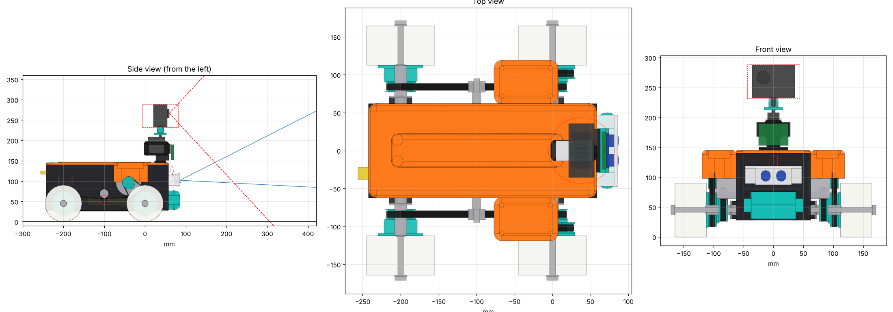
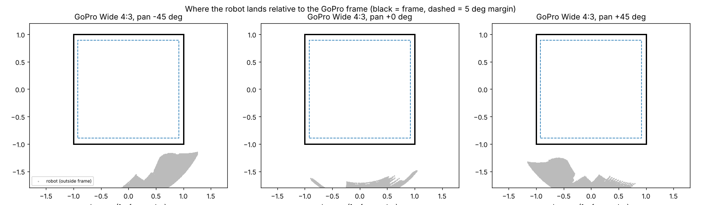

# honebot chassis CAD (Fusion 360 script): design, checks, build notes (2026-11-16, 4-wheel skid steer)

Files:
- `cad/fusion/HonebotChassis/HonebotChassis.py` (+ `.manifest`): **Fusion 360 script that builds the whole robot**:
  15 printed parts on the robot (+ a bench-only 9 g servo adapter and a drill jig, both hidden), reference hardware and
  keep-out volumes. It is the single geometry source.
- `cad/check_design.py`: offline checker. It imports the same file without Fusion and checks:
  - clearances, holes and assembly paths;
  - the GoPro view;
  - mass/CG, braking, pivot turns and structure;
  - the sensor beam, wiring and printability.

  Output: `cad/report/check_report.md` + `views.png` + `camera_views.png`.
- `cad/tests/test_fusion_script.py`: runs the Fusion code path against a stand-in `adsk` API (Python errors, bad
  geometry such as zero-length cylinders or non-orthogonal boxes).

> **Run it:** Fusion → Utilities → Add-Ins → Scripts and Add-Ins → "+" next to *My Scripts* → pick the
> `cad/fusion/HonebotChassis` folder → select *HonebotChassis* → Run. Expect a new document and a message
> **"built 87 of 87 parts"**. The previous (caster) version built 72 of 72 in the owner's Fusion; this version uses
> the same API calls. If any part or boolean fails, the message box names it: send the text back.
> If the model looks like it is lying on its back, your Fusion uses "Y up": the script models Z up (x forward, y left).

## 1. What changed and why

### 2026-11-16 (later): caster → 4-wheel skid steer

| Topic | Caster version | Now | Why |
|---|---|---|---|
| Wheels | 2 driven front wheels + swivel caster at the rear (tail module) | **4 wheels, all driven**. Each side has one motor: motor → 28T:56T belt → front wheel; the front wheel's **double pulley** (56T + 36T) → **1:1 belt** (HTD 510-3M-09) → 36T on the rear wheel | Fewer, simpler parts: no caster fork, swivel bearings, M12 pivot, tail, hood or lap joint. The caster parts carried the lowest safety factors (1.5); they are gone. No shimmy. All four wheels brake. Diff-drive software is unchanged |
| Frame | Tub + bolted tail + hood + lid + 2 pods | **One 300 mm tub**, both axles in it. **One shell** (lid + both motor pods, 4 screws). ESP32 cradle printed on the deck. UWB plate printed on the mast | Printed parts **20 → 15**. One lap joint and ~20 screws fewer |
| Rear-belt tension | — | **Idler (2 × 608-2RS side by side)** on an M8 hex bolt in a vertical wall slot, pressing the 1:1 belt's upper run down at mid-span. The wheelbase (**200.0 mm**) is solved from the belt length for 2 mm of take-up; the 15.6 mm slot covers 0.3–4.5 mm (±0.3 % print shrink on 200 mm is ±1.2 mm of belt path, plus belt tolerance). The bolt head sits in a hex channel inside, so the nyloc tightens from outside | Rear axle stays a fixed captive-nut stub axle like the front one |
| Pulley fixing | M3 × 80 through the wheel core into nylocs | **Heat-set inserts in the pulleys**, M3 screws from the wheel's outer face | The 36T neck left no room for a nut; 16 nuts fewer |
| Axle sleeves | 7075 turned 18 mm | **Stock steel tubes**: 12 × 2 inside 16 × 2 (E355, no lathe) | Buyable; SF 2.0 |
| Size / mass | 399 × 343 × 173 mm, 3.4 kg | **343 × 343 × 147 mm** (mast off), 288 mm tall with the GoPro, **≈ 3.8 kg** (estimate) | Two more wheels, axles and belts (+0.4 kg); shorter (no tail) |
| Stability | sideways tip 0.79 g, pitch-over 0.71 g | **sideways 1.75 g, pitch-over 0.89 g**, backward 1.65 g | Rectangle of 4 contacts instead of a triangle |

Costs of skid steer, and how they are handled:
- **Turning scrubs the tyres sideways.** Pivoting needs ~11 N per side, about 10 A per motor near standstill (30 A ESCs).
  The ratio wheelbase/track = 0.72 (< 1 is required) keeps that low.
- **Yaw rate is lower than the kinematic (vR − vL)/track**: set `track_width` in the bridge 1.2–1.6 × the geometric
  0.277 m after a spin test, and expect a small turn dead-band.
- **More tyre wear** on hard pivots: prefer arcs in the follower.

### Earlier decisions that still hold

| Topic | Decision | Why |
|---|---|---|
| Drive at the front | Front axle carries 65 % of the weight | Braking stability; the CG must stay behind the front axle (pitch-over) |
| Motors | **Reference MAD 5010 EEE V2.0 370KV** (published size, base and prop holes). **Printed 28T HTD-3M pulley bolted to the bell's prop holes** → printed 56T (2:1), 258 mm belt. Replaceable round motor plate with a universal slotted pattern; **pull screw** gives belt tension a positive stop | Generic 5010 listings disagree on pattern and shaft; bolting to the bell needs no shaft length. HTD-3M prints better and skips less than GT2 |
| Axles | **M8 × 140 stub axles (12.9) from outside into a captive nyloc**; all-metal stack: head, 608, wheel spacer, 608, speed washer, outer sleeve, collar 8.4 × 30 × 2, inner sleeve through the boss, nut | Each wheel comes off with one bolt. Located sideways without clamping plastic |
| Battery | Floor tunnel, loaded from the front behind the bumper-door | Low CG, tool-free charging |
| Camera | Removable mast at the nose, standard servo pan head | Nothing of the robot in frame at ±45° pan, even in Wide 4:3 |

### Drivetrain options checked (checker §6; 3S nominal, 90 mm wheels, needs ≥ 6.5 N at 15 mph)

| Option | Top speed (no load) | Thrust at 15 mph | Motor mass | Verdict |
|---|---|---|---|---|
| **5010 370KV + 28T:56T HTD-3M** (chosen) | 21.6 mph | 52 N (48 N on a sagged pack) | ≈ 0.30 kg | OK, wide margin (software caps the speed). Low-speed weakness handled by AM32 sine start-up (see below) |
| 5010 370KV + 20T:48T, pulley on a long shaft | 18.0 mph | 35 N | ≈ 0.30 kg | OK, but needs a motor with ~25 mm of free shaft |
| goBILDA 5203 3.7:1 planetary (brushed), direct | 15.8 mph | 1.1 N | 0.80 kg | Fails: no torque left near 15 mph, ~19 W peak per motor |
| same with 107 mm wheels | 18.8 mph | 3.7 N | 0.80 kg | Fails |
| Hoverboard hub motors | ~10–12 mph | high | ~5–6 kg | Too heavy and too slow for a backpack robot |
| e-skate 5055/5065 sensored + VESC | > 20 mph | high | ~1.2 kg | Best low-speed control, but ~$200+ in controllers and twice the weight |
| Small servos / actuators | ~1 m/s | — | — | Not suitable for continuous wheel drive |

Longevity measures for the chosen drive:
- **Shell pods** over the motors' upper half and the motor pulleys. They keep off spray from above; they are open
  toward the wheel, so grit thrown by the wheel can still reach the lower half.
- The weather-resistant reference motor and sealed 608 bearings.
- Belt slots for tensioning.
- AM32 **sine start-up** (a slow-speed mode for crawlers, part of the AM32 firmware) for smooth starts.

If start-up still stutters under load, the motor plate and pulley are the only parts to change for a sensored motor later.

**Speed vs ratio** (reprint the pulleys; change `pul_m_t`, `pul_w_t` and `belt_len`, then re-run the checker):
28T:56T ≈ 21.6 mph no-load (chosen; plenty of thrust and headroom, cap the speed in software). The 28T motor pulley
(not 24T) keeps ~3 mm of plastic between the screw counterbores and the tooth roots.

**Belts and pulleys.** Each belt is modelled as a true loop: two tangent runs plus the wrap arcs, 2 mm thick over the
tooth tips. The checker tests it against everything around it. The 28T pulley has 10–11 teeth in mesh.
**Tension:** press the belt at mid-span with about **2 N** (a 200 g weight); it should move **~1 mm** (span/64,
≈ 30 N per strand). Then tighten the pull screw against its boss, then the three plate screws.

**Pulley runout budget: ≤ 0.2 mm.** On 65 mm centres a 0.2 mm wobble swings belt tension by roughly ±15 N
(≈ half the pretension; belt stiffness [M]).
- **Wheel pulley:** centred by its four bolts in **3.15 mm close-fit holes**. The holes in the wheel core are
  drilled through the printed **pulley_drill_jig** (Tools group). The jig's spigot sits in the wheel's 22 mm
  bearing seat with the bearing removed, so the holes come out concentric with the wheel.
- **Motor pulley:** centred on the motor's shaft stub (bore drilled to fit, 8 mm deep) [M: confirm the stub stands
  ≥ 2 mm above the bell].
- **Check after assembly:** spin each pulley against a fixed pointer; no visible wobble.

**Motor shaft support.** The pulley is bolted straight to the bell, which keeps the overhang on the 5 mm shaft as
short as possible (~14 mm). At full pull the shaft sees ~68 MPa, a safety factor of 3.7 against fatigue. An extra
outboard bearing was evaluated and rejected: through a printed bracket it would be <1/7 as stiff as the shaft, so it
would carry <10 % of the load and could add stress through misalignment. The protections are the short overhang, the
tension spec above, and the pull-screw stop, which keeps tension from creeping up.

**Rear (1:1) belt and idler.**
- The loop is solved exactly: three pulleys, with tangent runs and wraps on the pitch line.
- With the belt at its nominal 510 mm, the idler sits ~14 mm below the straight run and takes up 2.0 mm.
- Slot ends: 0.3 mm take-up (idler high, z 69.3) to 4.5 mm (idler low, z 53.7). Belt and idler are drawn at the
  high end (closest to the motor); the swept idler travel is a checked keep-out.
- **Tension:** slide the idler down until the upper run between the idler and either pulley deflects ~1.5 mm under
  2 N at its middle, then tighten the M8 nyloc.
- The upper run passes 3–5 mm under the motor can even at the high end of the slot. The checked can is the Ø62
  envelope; the MAD motor is Ø56.
- **The rear belt goes on together with the wheels** (it loops both wheel pulleys; see §7).

## 2. Layout (mm; x forward from the front axle, y left, z up from the ground)

| Item | Where | Notes |
|---|---|---|
| Wheels 90 × 52 | front (0, ±138.5, 45), rear (−200.0, ±138.5, 45) | track 277, wheelbase 200.0 |
| Motors (≤ Ø62 × 33) | centre (−40, ±62…95, 96), outside the walls under the shell pods | 28T bolted to the bell, belt plane y ±102; **HTD-3M 258 mm** → 64.6 mm centres |
| Rear belt | plane y ±84, 36T:36T | **HTD 510-3M-09**; 2 × 608 idler at x −100, slot z 53.7–69.3 |
| Battery tunnel | x −141…4, \|y\| ≤ 26.5, z 32…62 | 3S 5000 hard case ≤ 145 × 50 × 30 |
| Fuse + distribution | under the deck, x −180…−146 (behind the battery) | 20 A blade fuse, XT30/Wago; XT60 arming plug in the rear wall |
| Deck (removable) | z 79…82 | Pi 5 (USB end to the rear), 2 regulators beside the mast socket, 2 ESCs zip-tied at the rear, **ESP32 slide-in cradle printed on** (x −195, PCB 30 mm above the deck so the jumper plugs on its downward pins clear), 10 mm M3 grid |
| HC-SR04 "eyes" | front, z 102, tilted up 12°, mounted upside down | ground return at 1.95 m (> `slow_distance` 1.0 m); plug rises behind the bracket into the wall hole at z 131 |
| Mast + pan head + UWB plate | x 38; servo seat z 195 | GoPro centre z 260, lens z 266 / x 60. UWB anchor on the front plate (z 151–192), antenna forward |

Power below the deck, signals above it:
- The battery lead runs back along the side channel (|y| ≈ 45, through Ø12 holes in the front bridge beam) to the
  fuse block behind the battery.
- Motor phase wires enter through grommets in the walls and run to the ESCs through the deck's cable passes.
- Signal cables run over the deck: GoPro USB-C, servo and UWB inside the hollow mast; ESP32 USB; HC-SR04.
- The mast has an open rear channel, so its cables lift out with it.
- Lengths are in report §9; cut them about 30 % longer.

## 3. Checks (all pass; full numbers in `cad/report/check_report.md`)

- **Clearances:**
  - 0.5 mm between static parts; 3 mm against anything moving or swept (wheels, pulleys, both belt loops, idlers,
    GoPro pan sweep, USB/jumper/HC-SR04 plug spaces, hex-key access to the motor-plate bolts).
  - Mated pairs must not interpenetrate.
- **Holes:**
  - Wall around every hole, and spacing between neighbours, are checked.
  - Every thread in plastic is a heat-set insert.
  - The fastener schedule is in report §11.
- **Assembly / service:** these slide out along their exit paths: mast, shell, deck, bumper-door, battery, each
  axle bolt, **both wheels of a side together with their pulleys and the rear belt**, each motor module. Each axle
  nyloc drops into its pocket from the battery tunnel (the battery rails are notched at the front axle).
- **Camera:** 0 robot points in frame for pan ±45° in every mode (5° margin). Allowed down-tilt is in the report.
  
- **Street → driveway** (up to a 20° slope change, lips up to 10 mm):

  | Angle | Clears |
  |---|---|
  | Approach | 21° |
  | Departure | 36° |
  | Breakover | 30° |
  | Gutter | 22° |

  - Floor at 28 mm. A driven wheel climbs a ~10 mm lip from standstill; treat lips as slow-down events.
- **Stability:**
  - Sideways tip at 1.75 g (it slides first).
  - Forward pitch-over under braking at 0.89 g; the bumper touches down at 22° if it does pitch.
  - Stopping from 15 mph: 4.5 m at μ 0.8, 5.5 m at μ 0.6.
  - Keep the firmware decel ramp (§8) at ~0.5 g anyway.
- **Structure at the worst road event:** a wheel hits a 6 mm crack at 15 mph, ~910 N (urethane stiffness 50 N/mm
  assumed: measure it, §8).

  | Item | Safety factor |
  |---|---|
  | Axle sleeve (nested steel tubes) | 2.0 |
  | M8 at the root / inside the wheel | 14.7 / 7.9 |
  | Axle boss bearing (PAHT-CF) | 1.6 |
  | Boss root | 6.7 |
  | Idler slot / 608 static | 63 / 45 |
  | Motor shaft | 3.7 |
  | Pivot-turn current (10 A vs 30 A) | 3.1 |
  | Pulley wall under the 36T teeth (4.7 mm vs 3 mm) | 2.3 |
  | Mast first mode | 118 Hz |
- **Wiring:** all 12 routes end at their connectors and avoid solids.
- **Printability:** every printed part fits 300 mm. The tub and the shell are 300 mm long; the H2C bed is
  325 × 320 mm.

## 4. Printing

| Part | Qty | Material | Orientation / supports |
|---|---|---|---|
| tub | 1 | PAHT-CF, 5–6 walls, 40 % infill, dry filament | Floor on the bed (300 × 140 fits straight). Supports under both axle bridge beams and the battery opening top. Inserts after printing |
| shell (lid + pods) | 1 | PETG, bright colour | Flat top down; supports inside the pods |
| motor_plate_L/R | 2 | PAHT-CF | Flat, counterbores up |
| wheel_pulley_FL/FR (56T + 36T), wheel_pulley_RL/RR (36T), motor_pulley_L/R (28T) | 4 + 2 | PAHT-CF, 0.4 nozzle, 0.12 mm layers | Axis vertical. Tooth form is approximate (round grooves); for best belt life regenerate the HTD-3M teeth with a pulley generator and keep hubs, flanges and holes. Motor pulley: drill the centre bore to the shaft |
| mast (with UWB plate) | 1 | PAHT-CF | Lying on its side; supports under the flange, head and plate |
| deck (with ESP32 cradle) | 1 | PETG (or PAHT-CF) | Flat, cradle up |
| bumper_door | 1 | PETG (TPU skin optional) | Back face on the bed |
| us_bracket, pan_buckle | 1 each | PETG | Plate down |
| servo9g_adapter, pulley_drill_jig | 1 each | PETG | Bench only / tool (hidden in Fusion) |

Tolerances are loose on purpose: through-holes M3/M4/M5/M8 3.4/4.5/5.5/8.5 mm; heat-set holes M3/M4 4.0/5.6 mm
(check your insert's chart); 0.3 mm per side slip fits; ≥ 3 mm next to anything that moves. Change them in `PARAMS`
and re-run both scripts.

## 5. Data quality: what is verified and what to measure

**Verified:** Raspberry Pi 5 holes · GoPro HERO9 71.0 × 55.0 × 33.6 mm, 158 g · Pololu D36V50Fx 25.4 mm square ·
MG996R body · HTD-3M pitch diameters · HTD 510-3M-09 and 258-3M belts are stock items.

**Measure before printing (you own these):** HC-SR04 transducer spacing and header; ESP32 DevKit width/length
(`esp_w` 28.5, `esp_l` 55); 9 g servo; GoPro lens offset.

**Measure on arrival (update PARAMS, re-run):**
- Motor: body length (≤ 33), prop holes (4 × M3 on D12), shaft stub height, M3 thread depth in the bell.
- ESC size: ≤ 48 × 27 × 14.
- Wheels:
  - bearing inset (sets the outer sleeve length);
  - a 12 × 8 spacer between the bearings;
  - solid core at Ø35 for the 4 pulley screws;
  - **urethane stiffness** (§8).
- Battery size; UWB anchor board size and holes.

## 6. Bill of materials (hardware not printed)

| Item | Qty | Notes |
|---|---|---|
| **MAD 5010 EEE V2.0 370KV** (reference), or a 5010-class 300–400 KV motor ≤ Ø62 × 33 with M3 base holes on 16–30 mm and **4 × M3 prop holes on D12** | 2 | Buy one generic 5010 first only if its listing gives all of these; measure, set PARAMS, re-run |
| M3 × 12 low-head (DIN 7984) | 8 | motor pulley → bell |
| HTD-3M **258 mm (86T)** × 9 mm closed belt | 2 (+1) | motor → front wheel |
| HTD-3M **510 mm (170T)** × 9 mm closed belt, e.g. Gates 510-3M-09 | 2 (+1) | front → rear wheel, 1:1 |
| 2 × 608-2RS + M8 × 55 hex bolt + spacer (wall → bearings, ~15 mm) + 8 × 12 shims + washer + M8 nyloc | 2 sets | rear-belt idlers (14 mm wide under the 9 mm belt) |
| AM32 ESC 30–40 A, 2–4S, PWM input, bidirectional | 2 | + USB linker; bidirectional, sine start-up, LVC 3.3 V/cell |
| 90 × 52 longboard wheels (4-pack) with 12 × 8 bearing spacers + 8 × 608-2RS | 1 | solid core at Ø35 |
| M8 × 140 hex bolt 12.9 + washer + 8 × 12 × 1.5 speed washer + M8 nyloc | 4 | stub axles |
| Axle stack per wheel: steel tubes **16 × 2** (inner 30.3 mm through the boss + outer cut to measure) over **12 × 2** (full length), collar washer 8.4 × 30 × 2 | 4 sets | E355 or stainless stock tube, cut and deburred. 12 × 2 in 16 × 2 and M8 in 12 × 2 are line-to-line nominal: plan to ream the 12 × 2 bore to 8.2 and sand the 12 mm OD to slide, or use a single 16 × 4 tube if you find one stocked |
| M3 × 55–60 socket screws | 16 | wheel outer face → inserts in the pulleys (≥ 5 mm into the insert, must not bottom in the 8 mm hole) |
| Heat-set inserts M3 × 5.7 (~40), M4 × 8.1 (~6) | | |
| M3 screws (shell 4, deck 4, motor plates 6, belt pull 2 × M3 × 25, HC-SR04 2), M4 thumb screws (mast 2, door 2) | | |
| Pololu D36V50F5 (5 V, Pi) + D36V50F6 (6 V, servo) | 1 + 1 | |
| XT60 pigtails, 20 A blade fuse holder, panel XT60 as arming plug | | pull the plug = everything off |
| MG996R or DS3218 servo + 470–1000 µF cap | 1 | |
| Right-angle USB-A cables (USB-C GoPro, micro-USB ESP32) | 2 | |
| 3S 5000 mAh hard case ≤ 145 × 50 × 30 | 1 | |

## 6b. Prototype kit: drive it before buying the metal

Hidden group **"Prototype kit"** in Fusion. Right-click → Save As Mesh, same as the printed parts. Limits are
calculated in report §7b.

| Part | Qty | Print | Replaces |
|---|---|---|---|
| proto_sleeve_in_* (inner sleeve + collar, 16 × 8.4 × 32.3) | 4 | PAHT-CF, collar on the bed, 100 % infill | steel 16 × 2 / 12 × 2 tubes + collar washer |
| proto_sleeve_out_* (outer sleeve + inner-race lip) | 4 | PAHT-CF, 100 % infill. Length = your wheel's bearing inset: measure first | outer steel tube + speed washer |
| proto_belt_motor (86T, printed 255.3 mm) | 2 | TPU, flat, 100 % infill, hardest TPU you have | HTD 258-3M-09 |
| proto_belt_rear (170T, printed 504.6 mm) | 2 | same | HTD 510-3M-09 |

- **Axles: keep the M8 × 140 12.9 bolts (about $2 each).** A fully printed axle can't work. The wheel bearings fix it
  at 8 mm, and an 8 mm PAHT-CF pin 76 mm out from the wall breaks at 20–50 N; a front wheel already carries 12 N
  standing still. With printed sleeves the bolt alone carries the bending: up to **~3.5 m/s (8 mph) over a 6 mm
  crack, ~2.8 m/s (6 mph) over a 10 mm lip**. Re-tighten the wheel bolts after the first runs, because plastic in
  the clamped stack creeps.
- **TPU belts: Bambu "TPU for AMS" (68D).** Its datasheet gives E ≈ 1190 MPa in X-Y and 600 MPa in Z (600 is used),
  with 22.4 MPa tensile strength in X-Y. The belts print flat, so the loop runs in X-Y. That is stiff enough that
  stretch is no longer the limit:
  - Belts print 257.6 mm and 509.3 mm long, so they reach full pitch at **15 N pretension**.
  - Belt pull is limited to 30 N by the slack side going loose. That covers cruising, hard acceleration and
    **turning in place** (18 N).
  - Tension: 2 N at the middle of a motor-belt span → ~2 mm deflection; rear-belt span → ~3 mm.
  - **Unknown: fatigue.** The 2 mm belt body bends to ~7 % surface strain around the 28T pulley at every pass, past
    where hard TPU stays elastic. Check the tooth roots for whitening or cracks after each session, and keep spares
    printed.
  - Print with 100 % infill, walls only if your slicer allows (the loop direction then carries the load), and the
    TPU for AMS profile.
- Swap in steel tubes and real belts (about $10–16 each) before going faster than a jog.

**Mesh check:** `python3 cad/check_manifold.py` scans every printed part for non-manifold edges (knife edges where
two solids or two cut-outs meet along a line). It found and fixed (2026-11-16): the motor-wire hole grazing the
motor-plate pad in the tub (4 edges), overlapping counterbore ends at the centre of the motor plates, and the
servo-lead notch corner on the mast's rounded edge. All parts now report "ok".

## 7. Assembly order

1. Inserts into the tub (shell, deck, motor-plate, door, HC-SR04, mast), motor plates and pulleys.
2. Motor → plate; 28T pulley → bell; plate into the wall pocket, 3 × M3 from inside, loose; pull screw loose.
3. Each axle: drop the M8 nyloc into its boss pocket from inside the tub; inner sleeve into the boss from outside, then
   the collar.
4. **Per side, wheels and rear belt together:** screw each pulley to its wheel (4 × M3 from the outer face). Loop the
   510 mm belt around both 36T pulleys. Then fit both wheels onto their axle stacks at once (outer sleeve, speed
   washer, wheel, washer, M8 × 140 from outside; turn until solid). Motor belt over the 28T and the 56T.
5. Idlers (after the wheels: even at the top of the slot the idler sits inside the belt path): M8 hex bolt from
   inside the tub (head in the hex channel), spacer, shim, 2 × 608, shim, washer, nyloc, loose.
6. Tension: motor belt with the pull screw (2 N → ~1 mm at mid-span), then the three plate screws; rear belt: slide
   the idler down (2 N → ~1.5 mm), then tighten its nyloc from outside.
7. Fuse block below the deck; wiring in the side channels; deck with the Pi, regulators, ESCs and ESP32; shell
   (4 screws); mast (2 thumb screws); GoPro.
8. Battery in from the front, bumper-door on (2 thumb screws).

Removing wheels: **the two wheels of a side come off together** (the rear belt cannot pass the 36T flanges): idler
up, motor belt off the 56T, both wheel bolts out, slide both wheels off with the belt. A motor-belt change therefore
means pulling that side's pair.

## 8. Tests before and after building

- **Wheel stiffness (5 minutes, now):** press a longboard wheel onto a 10 mm square bar on a kitchen scale. Read how
  many newtons each mm of compression takes, set `K_LIP` in `cad/check_design.py` and re-run. The structural
  forces scale with its square root.
- **HC-SR04 beam (now):** hold the sensor upside down at 100 mm, tilted 12° up, over empty floor.
  `/ultrasonic/range` should read `inf` or > 1.9 m; if it reads 0.5–1.5 m, tilt more (`us_tilt_deg`).
- **GoPro view (after printing the mast):** Wide 4:3, pan to ±1.0 with `ros2 topic pub /camera/pan_cmd …`; no robot
  part in frame.
- **Spin test (first drive, wheels on the ground):** command a slow pivot (`angular.z` 1.0 rad/s), measure the real
  yaw rate (phone compass/gyro app or a bag of `/cmd_vel` vs a video), and set the bridge's `track_width` so the two
  agree. Check the ESC current/temperature after 10 s of pivoting.
- **Firmware follow-up (safety):** the ESP32 drops to neutral instantly on fail-safe. With AM32 brake-on-stop that
  is a full-strength stop, close to the 0.89 g pitch-over limit. Ramp the command to zero at ~0.5 g instead.

## Prior art consulted

A short search found no published build that combines UWB following, outrunners with bell-mounted pulleys and a
printed differential drive. What informed this design:
- Makerfabs' UWB follow-me robot platform (in `hardware_plan.md`): one AoA anchor in front, following on range and bearing.
- A Fab Academy belt-driven differential transport robot: wheels with integrated printed pulleys.
- University capstone write-ups of UWB "follow-me wagons": tag on the user, anchors on the cart.
- Standard DIY e-skate practice: a wheel pulley bolted through the urethane wheel core, slotted motor mounts for
  belt tension.
- Standard RC-crawler practice: ESC sine start-up for low-speed control, an arming plug as the main switch.

## Sources (retrieved 2026-11-16)

- goBILDA 5203 3.7:1 data: [Abra Electronics](https://abra-electronics.com/robotics-actobotics-servocity/motion-en/dc-gear-motors-brushed/5203-series-yellow-jacket-planetary-gear-motors/5203-2402-0003-5203-series-yellow-jacket-planetary-gear-motor-3.7-1-ratio-24mm-length-8mm-rex-shaft-1620-rpm-3.3-5v-encoder-gobilda.html), [Core Electronics](https://core-electronics.com.au/5203-series-yellow-jacket-planetary-gear-motor-371-ratio-24mm-length-8mm-rex-shaft-1620-rpm-33-5v-encoder.html), [RobotShop](https://www.robotshop.com/products/5203-series-yellow-jacket-planetary-gear-motor-2691-223-rpm-33-5v-encoder)
- MAD 5010 EEE V2.0 (KV options incl. 370, O56 x 32.7, 5 mm shaft, base D25/D30 M3, prop D12/D18 M3): [mybotshop](https://www.mybotshop.de/MAD-5010-EEE-V20-brushless-drone-motor_1), [rcdrone.top](https://rcdrone.top/products/src-mad-467-5010-eee-v2-0-brushless-drone-motor), [MAD Components USA](https://www.madcomponentsusa.com/5010-eee-v2-0-drone-motor.html)
- Prior art: [Fab Academy belt-driven robot](https://fabacademy.org/2025/labs/bottrop/students/annasophia-brokuf/final-project/), [UIUC ECE445 UWB follow wagon](https://courses.grainger.illinois.edu/ece445/getfile.asp?id=24773)
- 5010 360KV variation between sellers: [RCTimer](https://www.rctimer.com/rctimer-5010-360kv-multicopter-brushless-motor-p0233.html), [Zbotic](https://zbotic.in/product/5010-360kv-high-torque-brushless-motor-for-drone/), [Amovrobot](https://amovrobotlab.com/products/5010-360kv-750kv-brushless-motor-motors); T-Motor MN5008: [GetFPV](https://www.getfpv.com/motors/commercial-cinematography-motors/t-motor-antigravity-mn5008-motor.html)
- AM32 (sine start-up, configurator): [am32-firmware/AM32](https://github.com/am32-firmware/AM32)
- Hobbywing QuicRun 1060 (brushed ESC, considered): [Hobbywing](https://www.hobbywingdirect.com/products/quicrun-10-esc-2-3s-brushed)
- Pololu D36V50F5: [pololu.com/product/4091](https://www.pololu.com/product/4091)
- GoPro HERO9 size/weight: [Willoughby's](https://www.willoughbys.com/GoPro_HERO9_Black_449200.html), [CameraSpecs](https://www.cameraspecs.co.uk/cameras/gopro/hero/gopro-hero9-black-682.html)
- MG996R: [Core Electronics](https://core-electronics.com.au/mg996r-metal-gear-servo-11-kg-cm.html); SG90: [Kpower](https://www.kpower.com/insight_servo/2399.html)
- Raspberry Pi hole template: [raspberrypi-spy](https://raspberrypi-spy.co.uk/?p=826)
- HC-SR04 bracket hole data (varies): [ProtoSupplies](https://protosupplies.com/product/hcsr04-ultrasonic-range-finder-module-bracket/)
- GoPro FOV figures used with a 5° margin are GoPro's published HERO9 values from memory (not re-retrieved); the
  live-preview test in §8 is the real check.
