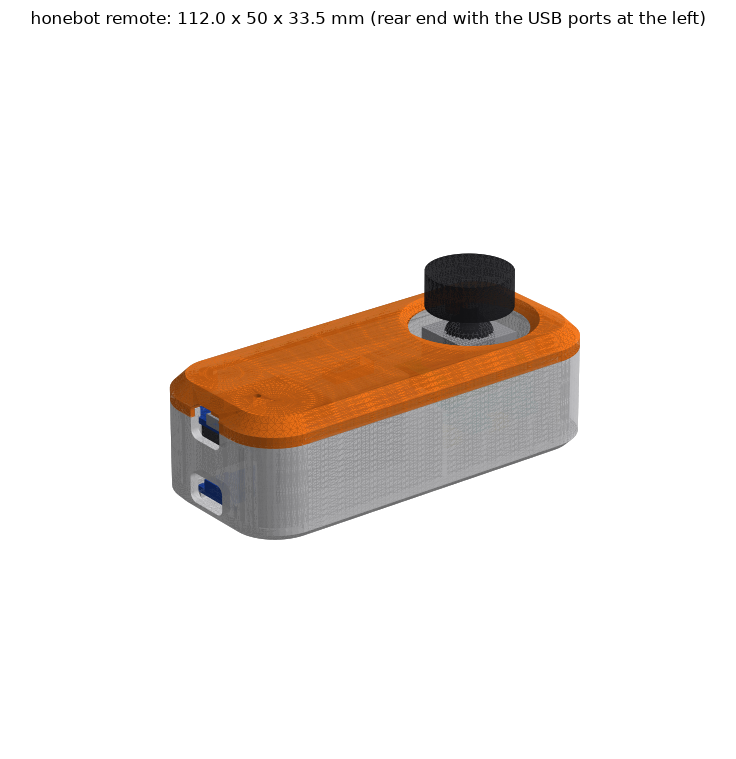
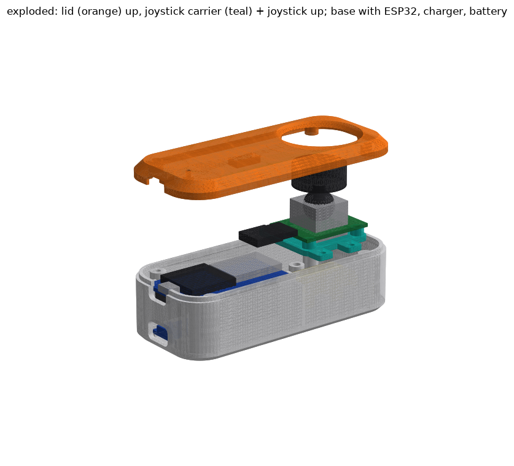
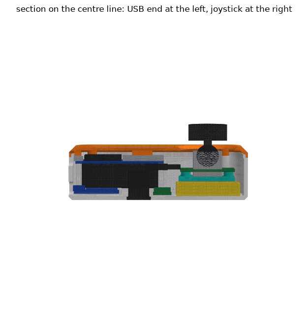

# Handheld remote case (2026-11-18)

A 3-D printed case for the handheld remote (`firmware/esp32_remote`). It holds:
- the ESP32 DevKit;
- the 5-pin joystick;
- a small LiPo with a USB-C charger;
- a power switch.

Files:
- `cad/remote_case/fusion/HonebotRemote/HonebotRemote.py` (+ `.manifest`): the **only geometry source**. Every
  dimension is in the `PARAMS` block at the top. It runs in Fusion 360 like the chassis script.
- `cad/remote_case/check_remote.py`: the offline fit and tolerance checker (numpy only). It writes
  `cad/remote_case/report/check_report.md`.
- `cad/remote_case/mesh_remote.py`: rebuilds the parts with OpenCascade. It writes the STL files and preview images.
- `cad/remote_case/stl/`: STL files in print orientation, built from the **default (unmeasured) PARAMS**. Print them
  only after your parts match the measure list in §4; otherwise edit PARAMS and re-export (§6):
  - `remote_base.stl`
  - `remote_lid.stl`
  - `js_carrier.stl`
- `cad/remote_case/tests/test_remote_script.py`: runs the Fusion code path against a stand-in API (also in CI).





## 1. What it looks like and why

**Size: 112 × 50 × 33.5 mm.** It is about the size of a thick TV remote.
- **Shape.** Rounded ends (14 mm corner radius) and a 45° bevel all round the top (4 mm) and bottom (2 mm).
  Bevels instead of round fillets because the base prints standing on its bottom and the lid prints upside down. A
  bevel on the bed side prints cleanly without support; a big round fillet there would droop.
- **How you hold it.** The thumb sits on the stick, about 25 mm from the front end. The palm wraps the rear half,
  where the ESP32 is.
- **Both USB ports are in the rear end**, one above the other:
  - top: the ESP32's own port, for flashing and serial;
  - bottom: the charger's USB-C.

Inside, from the rear (USB end) to the front:

| Zone | What | Why there |
|---|---|---|
| Rear, high | **ESP32 DevKit**, pins down, in a printed cradle. It rests on four corner ledges and is located by four guides. Two ribs on the lid stop it lifting: one over the WROOM module, one over the USB socket | The pins point down so your **existing female jumper wires keep working**: there are 19.5 mm free under the board for the housings plus a wire bend. USB at the rear end = flashing without opening the case. The antenna end points forward, away from your palm |
| Rear, low (under the ESP32, between its pin rows) | **TP4056 USB-C charger** (snap-in pocket), the **rocker switch** (snapped into the bottom, bezel flush), the **5 V step-up** (snap-in pocket) | These parts are only 5–16 mm tall and fit between the two rows of jumper housings |
| Front, low | **1S LiPo 1000 mAh** in a pocket on the floor, 8 mm or more from the ESP32 antenna | A metal-foil pouch right next to a PCB antenna costs range |
| Front, over the battery | **Joystick carrier** (printed plate, 4 screws to posts on the floor). The joystick module screws onto it | The carrier: (1) holds the battery down; (2) covers the joystick's sharp solder legs so they can't touch the pouch; (3) carries the stick's **click load straight into the floor**, not into the lid. The click is your STOP/RUN button, so it must feel solid |
| Lid | Cap with a **45° funnel around the stick** (Ø 32.8 at the inside, Ø 37.6 at the top) and a **light pipe** over the ESP32's blue LED | The funnel is sized by the script so the stick + cap keep 1 mm clearance at full tilt in every direction and when clicked. The cap (Ø 24) passes through it when the lid comes off |

**Lid to base:** a 2 mm lap joint (tongue on the base, rebate in the lid) aligns the two halves and hides the seam.
**Four M2 × 8 screws** go in from underneath, through counterbored columns, into heat-set inserts in the lid. The
screw heads sit 22 mm deep in the columns: you need a precision screwdriver or a 1.5 mm hex key with a shaft of
4 mm or less. No glue anywhere.

**LED window:** a Ø 2.0 mm hole in the lid right above the LED (`esp_led_dx/dy`). Push in a 5–6 mm stub of
**natural or clear 1.75 mm PETG or PLA filament** as a light pipe, or leave the hole open. The tube under it stops
light leaking to the rest of the case.

## 2. Power: which battery, charger and switch, and why

```
LiPo + (red) ──► TP4056 B+        TP4056 OUT+ ──► switch ──► step-up VIN        step-up VOUT ──► ESP32 5V / VIN pin
LiPo − (black) ► TP4056 B−        TP4056 OUT− ─────────────► step-up GND ─────────────────────► ESP32 GND
```

| Choice | Picked | Why not the alternatives |
|---|---|---|
| Battery | **1S LiPo 803040 (8 × 30 × 40 mm, ~1000 mAh)** with its own protection PCB and a JST-PH 2.0 lead | It fits under the joystick. Runtime ≈ **5 h**: the ESP32 with ESP-NOW draws ~120 mA at 5 V, and through the step-up that is ~190 mA from the cell. A 500 mAh cell gives ~2.5 h. A thinner 603450 (6 × 34 × 50) works too: set `bat_*` and the case grows to 122 × 53.5 × 32 by itself |
| Charger | **TP4056 USB-C module *with protection*** (DW01A + 8205A, outputs marked OUT+/OUT−), ~28 × 17 mm | It is cheap and common. The protection chip cuts the load off before the cell is over-discharged (2.5 V), which a bare 1S LiPo needs. Its default 1 A charge current suits a 1000 mAh cell (1C). **With a cell under 1000 mAh, change the module's PROG resistor** (1.2 kΩ = 1 A, 2.4 kΩ = 0.5 A) |
| Step-up | **Pololu U1V11F5** (5 V fixed, 11.4 × 10.2 mm) | The DevKit's VIN pin feeds an AMS1117 regulator that needs ≥ 4.3 V. A LiPo gives 4.2 V down to 3.3 V, so it must be boosted. The Pololu is a fixed 5 V, so there is no trim pot to mis-set. An MT3608 board also works, but it ships at a random voltage: set it to 5.0 V **before** connecting it, and it needs a 22 × 17 mm pocket (change `bst_*`) |
| Switch | **Mini rocker, snap-in, 15 × 10 mm bezel** (KCD11 / KCD117S class, 3 A) | It snaps into a cut-out with no screws or nut. It sits flush in a recess in the bottom, so it can't be knocked off by accident. Switching off is always safe: the robot stops within 0.5 s when it loses the remote. A slide switch would need a printed clamp and is easier to bump |
| Not chosen | Power-bank-style boards (IP5306) | Many shut their output off below ~50 mA after half a minute, and they are larger |

Rules (also in `firmware/esp32_remote/README.md`):
- **Charge with the switch OFF.** The switch sits after OUT+, so charging works while it is off. If the remote runs
  while charging, the TP4056 sees the remote's current too and may never decide the cell is full.
- **Check the battery lead's polarity before you solder.** JST-PH leads on hobby LiPos are not standardised. Red must
  go to B+. Reversed, the TP4056 is destroyed and the cell can be damaged.
- **Flashing:** plug USB into the ESP32's port at the top of the rear end. Either switch position works. With the
  switch off, the board runs from USB only, which is the cleanest.
- Some TP4056 USB-C boards lack the CC resistors, so **USB-C-to-C cables may not charge them**. Use a USB-A-to-C
  cable, or check yours.
- The battery must have its own protection PCB, or rely on the TP4056's DW01A. Never use an unprotected bare pouch
  without one of them.

## 3. Parts list

| Qty | Part | Notes |
|---|---|---|
| 1 | ESP32 DevKit (WROOM-32), the one you flashed | 38-pin default; for a 30-pin board set `esp_l` 51.5, `esp_pins_side` 15 |
| 1 | 5-pin joystick module (KY-023 class) | the one you have |
| 1 | 1S LiPo 803040 ~1000 mAh, protection PCB, JST-PH 2.0 lead | any pouch ≤ 8 × 30 × 40 (change `bat_*` for others) |
| 1 | TP4056 USB-C charger module with protection (OUT+/OUT− pads) | |
| 1 | Pololu U1V11F5 5 V step-up | or MT3608 set to 5.0 V (bigger pocket) |
| 1 | Mini rocker switch, 15 × 10 mm snap-in (KCD11 / KCD117S), 2-pin ON/OFF | check its cut-out drawing (`sw_cut_*`) |
| 12 | M2 heat-set inserts (your M2 inserts, 3.6 mm hole) | 4 in the lid, 4 in the base posts, 4 in the carrier |
| 4 | M2 × 8 screws | lid → base, from underneath |
| 8 | M2 × 6 screws | carrier → base (4), joystick → carrier (4) |
| ~30 cm | thin silicone wire (26–24 AWG), heat-shrink | power wiring |
| 1 | 1.75 mm natural / clear filament stub, 6 mm | light pipe (optional) |

Screw lengths are checked: M2 × 8 gives 3.5 mm of thread in the lid inserts, and M2 × 6 gives 3.6–3.7 mm. If you
only have other lengths, change `case_screw_len`, `carrier_screw_len` and `js_screw_len` and re-run the checker; it
fails if a screw is too short (under 2.5 mm of thread) or would bottom out.

## 4. Measure first (the `[M]` PARAMS)

These differ between sellers. Measure with calipers, edit `PARAMS`, then re-run the checker and the mesher (§6).
Most of the case resizes itself: length, height, the stick funnel, the screw-column positions and (above the 50 mm
minimum `W`) the width are derived from the parts.

| What | PARAMS | Default |
|---|---|---|
| ESP32 board length × width, pins per side | `esp_l`, `esp_w`, `esp_pins_side` | 55 × 28.5, 19 |
| ESP32 USB socket: width, height, how far it sticks out past the board edge | `esp_usb_w/h/l`, `esp_usb_over` | 8 × 3 × 5.5, 1.0 (micro-USB) |
| Blue LED position: from the USB-end edge / from the board centre line (+ = left with the USB end toward you) | `esp_led_dx`, `esp_led_dy` | 8, −6 |
| **Your cables' plug overmoulds** (the plastic part, width × height) | `esp_plug_w/h`, `tp_plug_w/h`, `plug_r` | 11 × 8, 12.5 × 7 |
| Joystick board, hole spacing, stick position from the header edge | `js_l`, `js_w`, `js_hole_dx/dy`, `js_stick_dx` | 34 × 26, 27 × 20, 17 |
| Joystick frame height, cap Ø and height above the board, max tilt | `js_frame_h`, `js_cap_d`, `js_cap_z0`, `js_cap_h`, `js_tilt` | 11, 24, 18, 10, 25° |
| Battery L × W × H | `bat_l`, `bat_w`, `bat_h` | 40 × 30 × 8 |
| TP4056 board and its USB-C socket | `tp_l`, `tp_w`, `tp_usb_*` | 28 × 17.2 |
| Rocker: cut-out, bezel, depth behind the panel | `sw_cut_l/w`, `sw_bez_l/w/h`, `sw_depth` | 13.5 × 9, 15 × 10.3 × 2, 14.5 |
| Insert length, screw head | `ins_m2_len`, `m2_head_d` | 4.0, 3.8 |

To measure the joystick tilt: push the stick fully into one corner, then measure how far the top of the cap moves
sideways (`d`) and its height above the pivot (`h`, about the middle of the round dome). tilt = atan(d / h).

## 5. Print settings (Bambu Lab H2C)

- **Material: PETG** (tough, slightly flexible snap lips, survives a drop) or PLA. **Not PAHT-CF or PPS-CF**: carbon
  fibre is conductive enough to weaken the radio, and this is the kill switch.
- 0.4 mm nozzle, 0.2 mm layers, **4 walls**, 25 % gyroid infill, 4 top and 4 bottom layers. **No supports, no
  brim.** Textured PEI plate.
- The STL files are already oriented:
  - `remote_base`: on its bottom face. The switch recess and the USB openings are short bridges.
  - `remote_lid`: top face down, so the visible face is the smooth plate side.
  - `js_carrier`: flat, spacers up.
- Filament: base ~47 g, lid ~16 g, carrier ~4 g (`report/mesh_report.md`).
- The snap lips over the TP4056 and the step-up are 0.8 mm wide and overhang the boards by 0.4 mm. If a board will
  not go in on the first print, shave the lip with a knife rather than forcing the board.

## 6. Check and re-export after changing PARAMS

Mac, from the repo root. One-time setup (the same venv as `cad/check_mesh.py`):
```bash
python3 -m venv ~/occ && ~/occ/bin/pip install cadquery-ocp==8.0.1.1.0 trimesh==5.2.1 numpy matplotlib
```
Fit checks (~6 min with all variants; `--quick` = default PARAMS only, ~45 s). You should see every line PASS, every
negative test "caught", and exit code 0:
```bash
~/occ/bin/python cad/remote_case/check_remote.py
```
STL files and preview images (~15 s). You should see `0 0` in the nm/open columns for all three parts:
```bash
~/occ/bin/python cad/remote_case/mesh_remote.py
```
Fusion script stand-in test (plain python3, no venv):
```bash
python3 cad/remote_case/tests/test_remote_script.py
```

What the checker covers:
1. **No overlaps** between any two solids (printed parts, boards, battery, switch, cable plugs).
2. Every printed part stays **inside the outer shell**.
3. **Clearance policy**, built from the hardware outlines, not from the case features:
   - boards: 0.3 mm per side;
   - battery: 0.5 mm per side and 0.8 mm swell room;
   - hold-down ribs: 0.3 mm above the parts;
   - cable plugs: 0.75 mm round the overmould;
   - switch bezel and body;
   - jumper housings on any DevKit pin.
4. **Joystick sweep**: the stick and cap, grown by 1 mm, swept every 15° round, at five tilts up to the maximum and
   when clicked.
5. **Assembly**: the lid lifts straight off over the cap; the carrier and joystick lift out; the battery and the ESP32
   lift out.
6. **Numbers**:
   - screw thread engagement and the insert-hole depths;
   - top skin over the inserts;
   - the lap joint stays under the top bevel;
   - the switch panel thickness;
   - the ESP32 ledges end before the first jumper housing;
   - the USB openings against the bevels;
   - **radio**: the battery at least 8 mm from the antenna, no brass insert within 12 mm of it, no carbon-filled
     material.
7. The same suite over **variants**: 30-pin DevKit, USB-C DevKit, a bigger cap with 30° tilt (the case widens to 54 mm
   for the funnel), and the 603450 battery (122 × 53.5 × 32).
8. **Negative tests** that must fail:
   - lid opening 3 mm too small;
   - case 2 mm too low;
   - ESP32 1 mm longer than the printed cradle;
   - battery 2 mm wider than the pocket;
   - switch panel too thick.

What it does **not** prove: the `[M]` numbers themselves. Measure them. Bambu-specific shrink is not modelled;
the clearances are meant to absorb it.

## 7. Assembly

On a bench, before closing anything:

1. **Inserts** (soldering iron ~220 °C for PETG, insert tool or a conical tip; press until flush):
   - 4 into the lid bosses, from the open side;
   - 4 into the base's carrier posts;
   - 4 into the carrier's spacers, from the top.
2. **Switch:** snap it into the bottom from outside, bezel into the recess, ON side toward the USB end.
3. **Solder the power chain** (§2) with ~6 cm leads:
   - battery JST pigtail → TP4056 B+/B−;
   - OUT+ → switch → step-up VIN;
   - OUT− → step-up GND;
   - step-up VOUT → a female jumper for the DevKit's **5V/VIN** pin;
   - GND → a female jumper for a **GND** pin.

   Check with a multimeter before connecting the ESP32: switch ON → **5.0 V** on the jumper, switch OFF → 0 V.
4. **TP4056:** push it down into its pocket, USB-C toward the rear opening, until the two lips click over the board
   edges. Push the **step-up** into its pocket the same way.
5. **Battery:** into its pocket, lead toward the rear (there is a gap in the pocket's rear wall).
6. **Joystick:**
   - Screw it onto the carrier (4 × M2 × 6), **header toward the rear (USB end)**.
   - Plug in your five jumpers; route them rearward.
   - Screw the carrier onto the four posts (4 × M2 × 6).
7. **ESP32:**
   - Plug the 7 jumpers onto its pins (joystick: 3V3, GND, 34, 35, 32; power: 5V/VIN, GND).
   - Lower it into the cradle, USB end into the rear opening, pins down.
   - Tuck the wires into the space under it.
8. **Lid:** put the filament light pipe in the LED hole, place the lid (the stick passes through the funnel), and turn
   it over. Screw in the 4 × M2 × 8 from underneath; snug, not tight.

**Check it:**
- Switch on: the LED shows through the light pipe.
- Then do the README's direction check (`firmware/esp32_remote/README.md`, "Build, flash, check"): push the stick
  away from you → `x=+1.00`, push it left → `y=+1.00`.
- **The case fixes the stick's orientation** (header toward you), and that may differ from how you held the loose
  module. If an axis is wrong, set `SWAP_XY`, `X_REVERSED` or `Y_REVERSED` in the sketch and flash again through the
  rear port.
- Then click and hold the stick: it must feel solid. The carrier takes the load into the floor.

**Range test** (the README asks for it): with the case closed, walk away from the robot until the remote's LED goes
to a slow blink, and note the distance. Hold the remote normally while you do it, because your hand covers the rear
half.

**Taking it apart:** 4 screws underneath → lift the lid straight up → everything is reachable. The carrier comes out
with 4 more screws (unplug the joystick jumpers first). Nothing is glued.

## 8. Limits and ideas

- Thickness (33.5 mm) is set by the joystick stack over the battery:
  battery 8 + swell 0.8 + carrier 2.4 + solder legs 3.5 + board 1.6 + frame 11 + lid 2.4.
  - A 6 mm battery saves 2 mm.
  - Soldering the joystick wires instead of using jumper housings would not make it thinner (the ESP32 is not the
    tallest stack).
- The stick funnel is large (Ø 37.6) because the stock cap sits low and tilts 25°. A taller cap allows a smaller funnel:
  change `js_cap_z0`, and the checker re-sizes the funnel.
- The jumper wires from the joystick pass under the ESP32's antenna end. That is acceptable for thin wires; keep the
  power wires along the side walls instead.
- Not modelled: the wires themselves; the TP4056 LEDs are not visible from outside. Charging takes ~1.2 h at 1 A;
  a USB meter or the switch-on LED tells you when it's done.

Sources for the `[V]` numbers (one listing each; still measure):
- KY-023 34 × 26 mm and hole spacing 27 / 20 mm:
  [fluxworkshop](https://fluxworkshop.com/products/biaa100065-dual-axis-joystick-keyes-black),
  [joy-it](https://joy-it.net/en/products/COM-KY023JM).
- TP4056 USB-C 28 × 17 mm and the CC-resistor note:
  [easyelecmodule](https://easyelecmodule.com/product/tp4056-1a-lithium-battery-protection-type-c-interface),
  [tinytronics](https://www.tinytronics.nl/en/power/bms-and-chargers/li-ion-and-li-po/with-protection-circuit/tp4056-usb-c-li-ion-charger-1a-with-li-ion-protection-circuit).
- KCD117S mini rocker, 13.5 × 9 mm cut-out, 14.8 × 10.3 × 16.5 mm:
  [envistiamall](https://envistiamall.com/products/mini-rocker-switch-2-pin-on-off-spst-125vac-6a-250vac-3a-black-117s).
