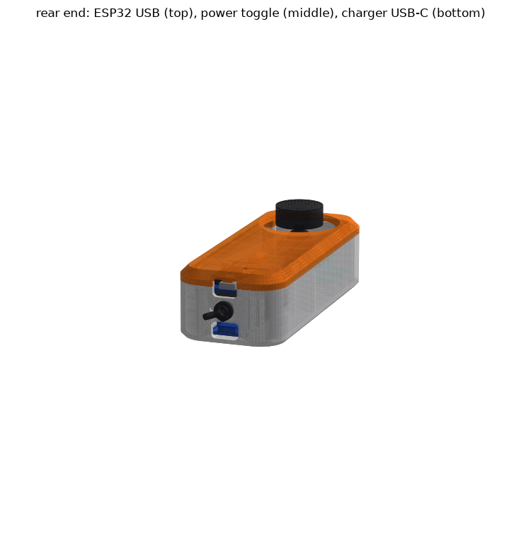

# Handheld remote case (2026-11-18)

A 3-D printed case for the handheld remote (`firmware/esp32_remote`). It holds:
- the ESP32 DevKit;
- the 5-pin joystick;
- a small LiPo with a USB-C charger;
- a power switch.

Files:
- `cad/remote_case/fusion/HonebotRemote/HonebotRemote.py` (+ `.manifest`): the **only geometry source**. Every
  dimension is in the `PARAMS` block at the top. It runs in Fusion 360 like the chassis script.
- `cad/remote_case/check_remote.py`: the offline fit and tolerance checker (numpy only). It writes
  `cad/remote_case/report/check_report.md`.
- `cad/remote_case/mesh_remote.py`: rebuilds the parts with OpenCascade. It writes the STL files and preview images.
- `cad/remote_case/stl/`: STL files in print orientation, built from the **default (unmeasured) PARAMS**. Print them
  only after your parts match the measure list in §4; otherwise edit PARAMS and re-export (§6):
  - `remote_base.stl`
  - `remote_lid.stl`
  - `js_carrier.stl`
- `cad/remote_case/tests/test_remote_script.py`: runs the Fusion code path against a stand-in API (also in CI).




**2026-11-18 (later): sized for the Adafruit parts** in the owner's cart (§2): 1200 mAh LiPo #258, Micro-Lipo
USB-C charger #4410, MiniBoost 5 V #4654, mini toggle switch #3221. The case grew from 112 × 50 × 33.5 to
**134 × 54 × 35 mm**:
- **Longer:** the 1200 mAh cell is 62 mm long.
- **Wider:** the screw columns must sit beside its 34 mm width.
- **1.5 mm taller:** the toggle sits between the two USB ports, which needs vertical room.

The earlier choices (TP4056, Pololu step-up, flush rocker in the bottom) are still in the script: `sw_type =
"rocker"` and the old sizes in §4.

## 1. What it looks like and why

**Size: 134 × 54 × 35 mm.** It is about the size of a TV remote.
- **Shape.** Rounded ends (14 mm corner radius) and a 45° bevel all round the top (4 mm) and bottom (2 mm).
  Bevels instead of round fillets because the base prints standing on its bottom and the lid prints upside down. A
  bevel on the bed side prints cleanly without support; a big round fillet there would droop.
- **How you hold it.** The thumb sits on the stick, about 27 mm from the front end. The palm wraps the rear half,
  where the ESP32 is.
- **Everything you plug or switch is in the rear end**, one above the other:
  - top: the ESP32's own port, for flashing and serial;
  - middle: the **power toggle**, lever moving left / right;
  - bottom: the charger's USB-C.

Inside, from the rear (USB end) to the front:

| Zone | What | Why there |
|---|---|---|
| Rear, high | **ESP32 DevKit**, pins down, in a printed cradle. It rests on four corner ledges and is located by four guides. Two ribs on the lid stop it lifting: one over the WROOM module, one over the USB socket | The pins point down so your **existing female jumper wires keep working**: there are 19.5 mm free under the board for the housings plus a wire bend. USB at the rear end = flashing without opening the case. The antenna end points forward, away from your palm |
| Rear, low (under the ESP32, between its pin rows) | **Charger** (snap-in pocket, USB-C in the rear opening; the battery plug goes into its front end through a gap in the pocket wall). The **toggle's body**, behind the rear wall. The **MiniBoost** (snap-in pocket) | These parts are only 6–13 mm tall and fit between the two rows of jumper housings |
| Front, low | **1S LiPo 1200 mAh** in a pocket on the floor, 8 mm or more from the ESP32 antenna | A metal-foil pouch right next to a PCB antenna costs range |
| Front, over the battery | **Joystick carrier** (printed plate, 4 screws to posts on the floor). The joystick module screws onto it | The carrier: (1) holds the battery down; (2) covers the joystick's sharp solder legs so they can't touch the pouch; (3) carries the stick's **click load straight into the floor**, not into the lid. The click is your STOP/RUN button, so it must feel solid |
| Lid | Cap with a **45° funnel around the stick** (Ø 36.8 at the inside, Ø 41.6 at the top) and a **light pipe** over the ESP32's blue LED | The funnel is sized by the script so the stick + cap keep 1 mm clearance at full tilt in every direction and when clicked. The cap (Ø 24) passes through it when the lid comes off |

**Lid to base:** a 2 mm lap joint (tongue on the base, rebate in the lid) aligns the two halves and hides the seam.
**Four M2 × 8 screws** go in from underneath, through counterbored columns, into heat-set inserts in the lid. The
screw heads sit 23.5 mm deep in the columns: you need a precision screwdriver or a 1.5 mm hex key with a shaft of
4 mm or less. No glue anywhere.

**LED window:** a Ø 2.0 mm hole in the lid right above the LED (`esp_led_dx/dy`). Push in a 5 mm stub of
**natural or clear 1.75 mm PETG or PLA filament** as a light pipe, or leave the hole open. The tube under it stops
light leaking to the rest of the case.

## 2. Power: which battery, charger and switch, and why

All four parts are from Adafruit (one order, $20.80 on 2026-11-18):

```
battery JST plug ──► charger #4410 battery socket
charger BAT pad ──► toggle middle lug ── toggle outer lug ──► MiniBoost IN      MiniBoost OUT ──► ESP32 5V / VIN pin
charger GND pad ──────────────────────────────────────────► MiniBoost GND ───────────────────► ESP32 GND
```

| Part | Adafruit # | Why |
|---|---|---|
| **LiPo 3.7 V 1200 mAh**, 34 × 62 × 5 mm, JST-PH, protection circuit built in (cuts off at 3.0 V) | 258 | The remote draws ~190 mA from the cell (ESP32 + ESP-NOW ~120 mA at 5 V, through the step-up). The target is 2–4 h, which needs ≥ 800 mAh. Adafruit has nothing between 500 mAh (≈ 2.5 h) and 1200 mAh (≈ **6 h**, with room for ageing). #1578 (500 mAh) also fits: set `bat_*` and the case shrinks to 112 × 54.5 × 35 |
| **Micro-Lipo charger, USB-C** (MCP73831), 24 × 19 mm | 4410 | Small, USB-C. The battery plugs straight into it. It charges at **100 mA as shipped**: close the charge-rate jumper (on a v2 board it is a small switch, set to 500 mA) so the 1200 mAh cell fills in about 3 h instead of 12 |
| **MiniBoost 5 V @ 1 A** (TPS61023), 17.8 × 11.3 mm | 4654 | The DevKit's VIN pin feeds a regulator that needs ≥ 4.3 V; the LiPo gives 4.2 down to 3.0 V, so it is boosted to a fixed 5 V. Leave **EN** unconnected. If OUT stays at 0 V with the switch on, wire EN to IN |
| **Mini toggle switch** SPDT (MTS-102), M6 bushing, 6 mm hole | 3221 | Adafruit has no snap-in rocker. The toggle mounts in the rear end with its own two nuts. Its lever throws sideways, so it doesn't catch in a pocket. Rated 1 A at 24 V by Adafruit; the remote draws ~0.2 A. Switching off is always safe: the robot stops within 0.5 s when it loses the remote |

Rules (also in `firmware/esp32_remote/README.md`):
- **Charge with the switch OFF.** Charging works either way, but this charger has no load sharing: a running remote
  confuses its "full" detection.
- **Check the battery's plug before you plug it in.** Red must land on the charger's + mark. Adafruit cells match
  Adafruit chargers, but any other cell's JST lead may be reversed.
- **Toggle wiring:** use the middle lug and **one** outer lug. Check with a multimeter which lever position connects
  them. That position is ON: mark it, or put the lever toward the top of the remote when ON.
- **Flashing:** plug USB into the ESP32's port (the top opening). Either switch position works. With the switch off,
  the board runs from USB only, which is the cleanest.
- The battery plug sits at the charger's front end, about 45 mm behind the battery's rear end. If your battery's lead is
  shorter than ~50 mm, add a JST-PH extension: Adafruit 261 (female, 100 mm) + 3814 (male, 200 mm), soldered
  together.

## 3. Parts list

| Qty | Part | Notes |
|---|---|---|
| 1 | ESP32 DevKit (WROOM-32), the one you flashed | 38-pin default; for a 30-pin board set `esp_l` 51.5, `esp_pins_side` 15 |
| 1 | 5-pin joystick module (KY-023 class) | the one you have |
| 1 | Adafruit 258 LiPo 1200 mAh | §2 |
| 1 | Adafruit 4410 Micro-Lipo USB-C charger | set to 500 mA |
| 1 | Adafruit 4654 MiniBoost 5 V | |
| 1 | Adafruit 3221 mini toggle switch | comes with 2 nuts, a flat and a lock washer |
| 12 | M2 heat-set inserts (your M2 inserts, 3.6 mm hole) | 4 in the lid, 4 in the base posts, 4 in the carrier |
| 4 | M2 × 8 screws | lid → base, from underneath |
| 8 | M2 × 6 screws | carrier → base (4), joystick → carrier (4) |
| ~30 cm | thin silicone wire (26–24 AWG), heat-shrink | power wiring |
| 1 | 1.75 mm natural / clear filament stub, 5 mm | light pipe (optional) |

Screw lengths are checked: M2 × 8 gives 3.5 mm of thread in the lid inserts, and M2 × 6 gives 3.6–3.7 mm. If you
only have other lengths, change `case_screw_len`, `carrier_screw_len` and `js_screw_len` and re-run the checker; it
fails if a screw is too short (under 2.5 mm of thread) or would bottom out.

## 4. Measure first (the `[M]` PARAMS)

These differ between sellers. Measure with calipers, edit `PARAMS`, then re-run the checker and the mesher (§6).
Most of the case resizes itself: length, height, the stick funnel, the screw-column positions and (above the 50 mm
minimum `W`) the width are derived from the parts.

| What | PARAMS | Default |
|---|---|---|
| ESP32 board length × width, pins per side | `esp_l`, `esp_w`, `esp_pins_side` | 55 × 28.5, 19 |
| ESP32 USB socket: width, height, how far it sticks out past the board edge | `esp_usb_w/h/l`, `esp_usb_over` | 8 × 3 × 5.5, 1.0 (micro-USB) |
| Blue LED position: from the USB-end edge / from the board centre line (+ = left with the USB end toward you) | `esp_led_dx`, `esp_led_dy` | 8, −6 |
| **Your cables' plug overmoulds** (the plastic part, width × height) | `esp_plug_w/h`, `tp_plug_w/h`, `plug_r` | 11 × 8, 12.5 × 7 |
| Joystick board, hole spacing, stick position from the header edge | `js_l`, `js_w`, `js_hole_dx/dy`, `js_stick_dx` | 34 × 26, 27 × 20, 17 |
| Joystick frame height, cap Ø and height above the board, max tilt | `js_frame_h`, `js_cap_d`, `js_cap_z0`, `js_cap_h`, `js_tilt` | 11, 24, 18, 10, 25° |
| Battery L × W × H | `bat_l`, `bat_w`, `bat_h` | 62 × 34 × 5 (Adafruit 258) |
| Charger board, its USB-C socket, the battery plug sticking out of its front end | `tp_l`, `tp_w`, `tp_usb_*`, `tp_jst_len/w/h` | 24 × 19; plug 12 × 8 × 6.5. **Check the USB-C and the JST socket are on opposite short ends** (photos suggest so; the page does not say) |
| MiniBoost board | `bst_l`, `bst_w`, `bst_h` | 17.8 × 11.3 × 5.6 |
| Toggle nut across flats / thickness | `tg_nut_af`, `tg_nut_t` | 8 / 2 (the drawing does not give them) |
| (rocker option) cut-out, bezel, depth behind the panel | `sw_cut_l/w`, `sw_bez_l/w/h`, `sw_depth` | 13.5 × 9, 15 × 10.3 × 2, 14.5 |
| Insert length, screw head | `ins_m2_len`, `m2_head_d` | 4.0, 3.8 |

To measure the joystick tilt: push the stick fully into one corner, then measure how far the top of the cap moves
sideways (`d`) and its height above the pivot (`h`, about the middle of the round dome). tilt = atan(d / h).

## 5. Print settings (Bambu Lab H2C)

- **Material: PETG** (tough, slightly flexible snap lips, survives a drop) or PLA. **Not PAHT-CF or PPS-CF**: carbon
  fibre is conductive enough to weaken the radio, and this is the kill switch.
- 0.4 mm nozzle, 0.2 mm layers, **4 walls**, 25 % gyroid infill, 4 top and 4 bottom layers. **No supports, no
  brim.** Textured PEI plate.
- The STL files are already oriented:
  - `remote_base`: on its bottom face. The tops of the USB openings and the switch hole are short bridges.
  - `remote_lid`: top face down, so the visible face is the smooth plate side.
  - `js_carrier`: flat, spacers up.
- Filament: base ~58 g, lid ~20 g, carrier ~4 g (`report/mesh_report.md`).
- The snap lips over the charger and the MiniBoost are 0.8 mm wide and overhang the boards by 0.4 mm. If a board will
  not go in on the first print, shave the lip with a knife rather than forcing the board.

## 6. Check and re-export after changing PARAMS

Mac, from the repo root. One-time setup (the same venv as `cad/check_mesh.py`):
```bash
python3 -m venv ~/occ && ~/occ/bin/pip install cadquery-ocp==8.0.1.1.0 trimesh==5.2.1 numpy matplotlib
```
Fit checks (~6 min with all variants; `--quick` = default PARAMS only, ~45 s). You should see every line PASS, every
negative test "caught", and exit code 0:
```bash
~/occ/bin/python cad/remote_case/check_remote.py
```
STL files and preview images (~15 s). You should see `0 0` in the nm/open columns for all three parts:
```bash
~/occ/bin/python cad/remote_case/mesh_remote.py
```
Fusion script stand-in test (plain python3, no venv):
```bash
python3 cad/remote_case/tests/test_remote_script.py
```

What the checker covers:
1. **No overlaps** between any two solids (printed parts, boards, battery, switch, cable plugs).
2. Every printed part stays **inside the outer shell**.
3. **Clearance policy**, built from the hardware outlines, not from the case features:
   - boards: 0.3 mm per side;
   - battery: 0.5 mm per side and 0.8 mm swell room;
   - hold-down ribs: 0.3 mm above the parts;
   - cable plugs: 0.75 mm round the overmould;
   - the toggle's body, lugs, wire bend and inner nut;
   - the battery plug in front of the charger;
   - jumper housings on any DevKit pin.
4. **Joystick sweep**: the stick and cap, grown by 1 mm, swept every 15° round, at five tilts up to the maximum and
   when clicked.
5. **Assembly**: the lid lifts straight off over the cap; the carrier and joystick lift out; the battery and the ESP32
   lift out.
6. **Numbers**:
   - screw thread engagement and the insert-hole depths;
   - top skin over the inserts;
   - the lap joint stays under the top bevel;
   - the toggle: bushing long enough for the spot-faced wall (1.8 mm) + 2 nuts + washers; nut face and
     anti-rotation hole on the flat rear face, clear of both USB openings;
   - the ESP32 ledges end before the first jumper housing;
   - the USB openings against the bevels;
   - **radio**: the battery at least 8 mm from the antenna, no brass insert within 12 mm of it, no carbon-filled
     material.
7. The same suite over **variants**: 30-pin DevKit, USB-C DevKit, a bigger cap with 30° tilt, the Adafruit 500 mAh
   battery (112 × 54.5 × 35), and the rocker in the bottom instead of the toggle.
8. **Negative tests** that must fail:
   - lid opening 3 mm too small;
   - case 2 mm too low;
   - ESP32 1 mm longer than the printed cradle;
   - battery 2 mm wider than the pocket;
   - toggle bushing 3 mm too short;
   - charger 4 mm longer than its pocket.

What it does **not** prove: the `[M]` numbers themselves. Measure them. Bambu-specific shrink is not modelled;
the clearances are meant to absorb it.

## 7. Assembly

On a bench, before closing anything:

1. **Inserts** (soldering iron ~220 °C for PETG, insert tool or a conical tip; press until flush):
   - 4 into the lid bosses, from the open side;
   - 4 into the base's carrier posts;
   - 4 into the carrier's spacers, from the top.
2. **Charger:** set it to 500 mA (close the jumper, or set the switch on a v2 board).
3. **Toggle:**
   - Run one nut all the way down the bushing, then the lock washer.
   - From inside the base, push the bushing through the 6 mm hole in the rear end, lever horizontal.
   - Outside, put on the flat washer with its small tab in the 2.6 mm hole beside it, then the second nut. Tighten
     against the inner nut.
4. **Solder the power chain** (§2) with ~6 cm leads:
   - charger BAT pad → toggle middle lug; toggle outer lug → MiniBoost IN;
   - charger GND pad → MiniBoost GND;
   - MiniBoost OUT → a female jumper for the DevKit's **5V/VIN** pin;
   - GND → a female jumper for a **GND** pin.

   Plug the battery into the charger, then check with a multimeter before connecting the ESP32: switch ON → **5.0 V**
   on the jumper, switch OFF → 0 V.
5. **Charger and MiniBoost:** push the charger down into its pocket, USB-C toward the rear opening, until the two
   lips click over the board edges. Push the **MiniBoost** into its pocket the same way.
6. **Battery:** into its pocket, lead toward the rear (there is a gap in the pocket's rear wall). Its plug runs back
   along the floor to the charger's front end.
7. **Joystick:**
   - Screw it onto the carrier (4 × M2 × 6), **header toward the rear (USB end)**.
   - Plug in your five jumpers; route them rearward.
   - Screw the carrier onto the four posts (4 × M2 × 6).
8. **ESP32:**
   - Plug the 7 jumpers onto its pins (joystick: 3V3, GND, 34, 35, 32; power: 5V/VIN, GND).
   - Lower it into the cradle, USB end into the rear opening, pins down.
   - Tuck the wires into the space under it.
9. **Lid:** put the filament light pipe in the LED hole, place the lid (the stick passes through the funnel), and turn
   it over. Screw in the 4 × M2 × 8 from underneath; snug, not tight.

**Check it:**
- Switch on: the LED shows through the light pipe.
- Then do the README's direction check (`firmware/esp32_remote/README.md`, "Build, flash, check"): push the stick
  away from you → `x=+1.00`, push it left → `y=+1.00`.
- **The case fixes the stick's orientation** (header toward you), and that may differ from how you held the loose
  module. If an axis is wrong, set `SWAP_XY`, `X_REVERSED` or `Y_REVERSED` in the sketch and flash again through the
  rear port.
- Then click and hold the stick: it must feel solid. The carrier takes the load into the floor.

**Range test** (the README asks for it): with the case closed, walk away from the robot until the remote's LED goes
to a slow blink, and note the distance. Hold the remote normally while you do it, because your hand covers the rear
half.

**Taking it apart:** 4 screws underneath → lift the lid straight up → everything is reachable. The carrier comes out
with 4 more screws (unplug the joystick jumpers first). Nothing is glued.

## 8. Limits and ideas

- Thickness (35 mm) is set by the rear end: the charger's USB-C opening, the toggle's nut and the ESP32's USB
  opening are stacked above each other. With the rocker in the bottom instead (`sw_type = "rocker"`), it is 32 mm.
- The stick funnel is large (Ø 41.6) because the stock cap sits low and tilts 25°. A taller cap allows a smaller funnel:
  change `js_cap_z0`, and the checker re-sizes the funnel.
- The jumper wires from the joystick pass under the ESP32's antenna end. That is acceptable for thin wires; keep the
  power wires along the side walls instead.
- Not modelled: the wires themselves. The charger's LEDs (red charging, green done) are not visible from outside:
  charging takes ~3 h at 500 mA, or use a USB meter.

Sources for the `[V]` numbers (one listing each; still measure):
- Adafruit parts:
  - [258 battery](https://www.adafruit.com/product/258)
  - [4410 charger](https://www.adafruit.com/product/4410), and its
    [guide](https://learn.adafruit.com/adafruit-microlipo-and-minilipo-battery-chargers)
  - [4654 MiniBoost](https://www.adafruit.com/product/4654)
  - [3221 toggle](https://www.adafruit.com/product/3221), and its
    [MTS-102 drawing](https://cdn-shop.adafruit.com/product-files/3221/singe_blue_switch_diagram.jpg)
  - [1578 battery](https://www.adafruit.com/product/1578)
- KY-023 34 × 26 mm and hole spacing 27 / 20 mm:
  [fluxworkshop](https://fluxworkshop.com/products/biaa100065-dual-axis-joystick-keyes-black),
  [joy-it](https://joy-it.net/en/products/COM-KY023JM).
- TP4056 USB-C 28 × 17 mm and the CC-resistor note:
  [easyelecmodule](https://easyelecmodule.com/product/tp4056-1a-lithium-battery-protection-type-c-interface),
  [tinytronics](https://www.tinytronics.nl/en/power/bms-and-chargers/li-ion-and-li-po/with-protection-circuit/tp4056-usb-c-li-ion-charger-1a-with-li-ion-protection-circuit).
- KCD117S mini rocker, 13.5 × 9 mm cut-out, 14.8 × 10.3 × 16.5 mm:
  [envistiamall](https://envistiamall.com/products/mini-rocker-switch-2-pin-on-off-spst-125vac-6a-250vac-3a-black-117s).
